# BÁO CÁO TỔNG HỢP CHUYÊN ĐỀ THỊ GIÁC MÁY TÍNH: LAB 02 – LAB 03 – LAB 04
## TRƯỜNG ĐẠI HỌC GIAO THÔNG VẬN TẢI TP.HCM (UTH) — KHOA CÔNG NGHỆ THÔNG TIN

- **Môi trường thực nghiệm**: Python 3.14.8 | OpenCV 5.0.0 | PyWavelets 1.8.0 | Scikit-Image 0.26.0 | NumPy 2.2.6
- **Báo cáo Slide Trình Chiếu HTML tương tác 100vh**: [LABS_02_03_04_REPORT.html](LABS_02_03_04_REPORT.html)
- **Kiểm thử hồi quy tự động**: `58/58 passed` (100% tests cho 3 lab tại `tests/test_filters.py`, `tests/test_canny.py`, `tests/test_wavelet_hash.py`, `tests/test_lab04_baseline.py`, `tests/test_lab04_pairs.py`)

---

## 🚀 1. TỔNG QUAN ĐIỀU HÀNH & TIẾN TRÌNH LIÊN HOÀN 3 CHUYÊN ĐỀ

Chuỗi thực nghiệm kết nối xuyên suốt 3 tầng kiến trúc thị giác máy tính: từ **xử lý cường độ mức xám & tích chập không gian (Lab 02)** lên **tách biên tối ưu vi sai & nhận dạng hình học (Lab 03)** và đạt tới **trích xuất đặc trưng nhận thức sóng nhỏ Wavelet Hash RGB 192-bit (Lab 04)**.

```mermaid
flowchart TD
    subgraph LAB02 ["1. LAB 02: TOÁN TỬ KHÔNG GIAN & ĐIỂM ẢNH"]
        direction TB
        L2_IN["Ảnh Mẫu: image-2.jpg (1920×1080 BGR/Gray)"]
        L2_P1["Phần I: Point Ops (g = clip(α·f + β))<br/>β=±50, α={0.5, 1.8}, 255-f, T={80, 127, 180}"]
        L2_P2["Phần II: Linear Filters (Σ = 1.000)<br/>Mean (7×7, 21×21) vs Gaussian (k ≈ 6σ + 1) & Sharpen"]
        L2_P3["Phần III: Derivatives & Non-linear<br/>Sobel vs Prewitt (r≈0.996) & Median khử 100% cực trị muối tiêu"]
        L2_IN --> L2_P1 --> L2_P2 --> L2_P3
    end

    subgraph LAB03 ["2. LAB 03: TÁCH BIÊN CẢI TIẾN CANNY & HÌNH HỌC"]
        direction TB
        L3_IN["Ảnh Mẫu skimage: camera, brick (512×512), coins (303×384)"]
        L3_ST["5 Bước Toán Học Canny<br/>Gauss mượt → Sobel G,θ → NMS 1px → Ngưỡng kép → Hysteresis"]
        L3_EXP["Thực Nghiệm Chuyên Sâu<br/>• YC1: OpenCV (30,980 px) vs Skimage (7,554 px)<br/>• YC2: Quét σ (20,012 → 793 px) & 4 cặp ngưỡng<br/>• YC3: Cân bằng equalizeHist phục hồi ảnh mù (0 → 13,897 px)<br/>• YC4: Closing + fill holes (Mask 41,111 px) & HoughCircles (24/24 xu)"]
        L3_IN --> L3_ST --> L3_EXP
    end

    subgraph LAB04 ["3. LAB 04: WAVELET HASH RGB 192-BIT"]
        direction TB
        L4_IN["Tập Dữ Liệu: 26 Nguồn → 130 Ảnh (147 Cặp)<br/>Split không rò rỉ: Calib 66 cặp / Eval 81 cặp"]
        L4_WT["2D DWT db4 Level 1 (LL1 131×131 → 8×8)<br/>Lượng tử trung vị 64 bit/kênh → Vector [R|G|B] 192-bit"]
        L4_EV["Đánh Giá & Ứng Dụng<br/>• Ngưỡng Youden τ = 18 bits (Calib Acc = 100%)<br/>• Evaluation: 80/81 đúng (98.77% Acc, ROC AUC = 1.0000)<br/>• Top-3 Nearest Neighbor: Top-1 đạt chính xác 100% (D_H = 2)"]
        L4_IN --> L4_WT --> L4_EV
    end

    LAB02 --> LAB03 --> LAB04
```



### Bảng Ma Trận Nghiệm Thu Toàn Diện 3 Bài Lab

| Tiêu Chí So Sánh | Lab 02: Lọc Không Gian | Lab 03: Canny & Hough Circles | Lab 04: Wavelet Hash RGB 192-bit |
| :--- | :--- | :--- | :--- |
| **Ảnh mẫu thực nghiệm** | `image-2.jpg` (1920×1080 uint8) | `camera`, `brick` (512×512), `coins` (303×384) | 26 nguồn (Chihuahua-Muffin, Mèo-Kem) → 130 ảnh |
| **Bản chất toán học** | Tích chập 2D không gian & ánh xạ điểm | Tối ưu hóa 3 tiêu chí John Canny & tích lũy Hough | Biến đổi tần số không gian 2D DWT db4 & khoảng cách Hamming |
| **Độ dài / Chiều đặc trưng** | Giữ nguyên kích thước ảnh gốc | Bản đồ biên nhị phân 1-pixel & danh sách tọa độ (x,y,r) | Vector nhị phân cô đọng **192-bit** (48 ký tự Hex) |
| **Độ phức tạp tính toán** | $\mathcal{O}(H \cdot W \cdot k^2)$ | $\mathcal{O}(H \cdot W) + \mathcal{O}(H \cdot W \cdot R)$ | $\mathcal{O}(H \cdot W) + \mathcal{O}(1)$ so khớp bit bằng POPCNT |
| **Chỉ số kỹ thuật đột phá** | • Sobel vs Prewitt $r \approx 0.996$<br/>• Sharpen bảo toàn độ sáng $\Sigma = 1.000$<br/>• Median triệt tiêu 100% cực trị muối tiêu 3% | • OpenCV 30,980 px vs Skimage 7,554 px<br/>• equalizeHist cứu ảnh mờ: $0 \to 13,897$ px<br/>• HoughCircles bắt trọn vẹn **24/24 đồng xu (100%)** | • Ngưỡng tối ưu Youden $\tau = 18$ bits<br/>• Evaluation **80/81 đúng (98.77% Acc)**<br/>• ROC AUC = **1.0000** hoàn hảo, Top-1 Precision 100% |
| **Kiểm thử tự động** | **22 / 22 PASS** (`tests/test_filters.py`) | **11 / 11 PASS** (`tests/test_canny.py`) | **25 / 25 PASS** (`test_wavelet_hash`, `baseline`, `pairs`) |

---

## 📌 2. CHI TIẾT KỸ THUẬT CHUYÊN ĐỀ LAB 02: TOÁN TỬ ĐIỂM & LỌC KHÔNG GIAN

### 2.1. Phần I — Toán Tử Điểm Ảnh (YC1–YC4)
- **YC1 (Độ sáng)**: $g(x,y) = \text{clip}(f(x,y) + \beta, 0, 255)$. Với $\beta = +50$, dải mức xám tịnh tiến sang $[50, 255]$; với $\beta = -50$, dải dịch sang $[0, 197]$. Phép cộng không làm thay đổi hình dáng lược đồ xám.
- **YC2 (Tương phản)**: $g(x,y) = \text{clip}(\alpha \cdot f(x,y), 0, 255)$. Với $\alpha = 0.5$, co dải động về $[0, 127]$ (ảnh bạc màu mờ đục); với $\alpha = 1.8$, kéo giãn dải mức xám, tăng độ tương phản rõ rệt nhưng bão hòa trắng tại 255.
- **YC3 (Âm bản)**: $g(x,y) = 255 - f(x,y)$. Đảo ngược toàn bộ thang sáng tối, giúp mắt người nhận diện rõ các chi tiết bị chìm trong vùng tối.
- **YC4 (Cắt ngưỡng & Histogram)**: Phân ngưỡng $g(x,y) = 255$ nếu $f(x,y) \ge T$ ngược lại bằng $0$. Với $T=127$, chia đều phân bố; lược đồ histogram sau cắt ngưỡng quy tụ về đúng 2 vạch rời rạc $\{0, 255\}$.

### 2.2. Phần II — Bộ Lọc Tuyến Tính (YC5–YC7)
- **YC5 & YC6 (Mean vs Gaussian Blur)**:
  - Mean filter gán trọng số đồng nhất $1/k^2$, tạo hiện tượng lem biên dạng ô vuông (box artifact).
  - Gaussian filter áp dụng hàm chuông chuẩn 2 chiều đối xứng tâm $G(x,y) = \frac{1}{2\pi\sigma^2}\exp\left(-\frac{x^2+y^2}{2\sigma^2}\right)$.
  - **Quy tắc kích thước kernel**: $k \approx 6\sigma + 1$ (bao trọn dải $\pm 3\sigma$) giúp tích hợp $99.73\%$ năng lượng, ngăn ngừa hiện tượng cắt cụt biên (truncation artifact).
- **YC7 (Làm nét Sharpening)**:
  - Bản chất toán học: $\text{Sharpen} = \text{Identity} - \text{Laplacian}$.
  - Đặc điểm nhận dạng: Kernel làm nét bắt buộc có tổng trọng số $\Sigma w_{ij} = 1.000$ (bảo toàn độ sáng trung bình) VÀ có hệ số âm ở lân cận để khuếch đại vi sai biên.
  - Phân biệt: Laplacian ($\Sigma = 0$) là toán tử tách biên, không phải làm nét.

### 2.3. Phần III — Đạo Hàm Biên Gradient, Tổng Kernel & Lọc Phi Tuyến (YC8–YC11)
- **YC8 (Sobel vs Prewitt)**: Đạo hàm bậc một theo hai trục trực giao $Gx, Gy$. Sobel gán trọng số trung tâm bằng 2 ($[1, 2, 1]$), tích hợp sẵn bộ lọc Gauss 1D khử nhiễu. Hệ số tương quan Pearson giữa hai toán tử đạt $r \approx 0.9961$; biên độ trung bình của Sobel lớn hơn Prewitt $\sim 1.37\times$ ($39.5$ vs $28.9$).
- **YC9 (Quy tắc tổng trọng số kernel)**: Kiểm chứng trên vùng phẳng $c = 100$:
  - $\Sigma = 0.5 \implies \text{output} = 50$ (tối đi một nửa năng lượng).
  - $\Sigma = 1.0 \implies \text{output} = 100$ (bảo toàn nguyên vẹn độ sáng).
  - $\Sigma = 2.0 \implies \text{output} = 200$ (cháy sáng).
  - $\Sigma = 0.0 \implies \text{output} = 0$ (vùng phẳng biến mất, chỉ giữ lại đường biên).
- **YC10 & YC11 (Lọc phi tuyến trên 3% nhiễu muối tiêu)**: Median Filter áp dụng thống kê thứ tự trung vị, loại bỏ triệt để $100\%$ điểm cực trị $0$ và $255$ mà không làm nhòe ảnh; Bilateral Filter làm mịn vùng phẳng giữ cạnh sắc nét nhưng không triệt tiêu hết hạt muối tiêu vì vẫn bản chất là trung bình có trọng số.

---

## 📌 3. CHI TIẾT KỸ THUẬT CHUYÊN ĐỀ LAB 03: TÁCH BIÊN CẢI TIẾN CANNY & HÌNH HỌC

### 3.1. 5 Bước Toán Học Canny Kinh Điển
1. **Gaussian Smoothing**: Làm mịn ảnh với bán kính $k = 2\lceil 3\sigma \rceil + 1$ để triệt tiêu nhiễu tần số cao.
2. **Sobel Gradient**: Tính biên độ $G = \sqrt{Gx^2 + Gy^2}$ và góc pháp tuyến $\theta = \text{atan2}(Gy, Gx)$.
3. **Non-Maximum Suppression (NMS)**: Lượng tử hóa góc gradient về 4 hướng chính ($0^\circ, 45^\circ, 90^\circ, 135^\circ$), chỉ giữ lại điểm cực đại cục bộ, gọt mỏng đường biên về đúng $1$ pixel.
4. **Double Thresholding**: Phân loại ứng viên biên thành 3 nhóm: Strong ($G \ge T_{\text{high}}$), Weak ($T_{\text{low}} \le G < T_{\text{high}}$), và Non-edge ($G < T_{\text{low}}$).
5. **Hysteresis Tracking**: Duyệt 8-lân cận, giữ lại các pixel Weak có liên kết trực tiếp với Strong; loại bỏ các điểm yếu cô lập.

### 3.2. Kết Quả Thực Nghiệm Trọng Tâm (YC1–YC4)
- **YC1 (OpenCV vs Scikit-image)**: Trên ảnh `camera` (512×512) với cùng ngưỡng 50/150, `cv2.Canny` giữ **30,980** pixel biên vs `skimage.feature.canny` giữ **7,554** pixel biên. Khác biệt do skimage tự động làm mịn Gauss nội bộ ($\sigma=1$) và chuẩn hóa dải float $[0, 1]$.
- **YC2 (Quét tham số $\sigma$ và ngưỡng kép)**:
  - Quét $\sigma$ cố định $T=50/150$: $\sigma=0.5$ (20,012 px) $\to \sigma=1.0$ (7,937 px mốc chuẩn) $\to \sigma=2.0$ (4,740 px) $\to \sigma=3.5$ (793 px, xóa sạch chi tiết nhỏ).
  - Quét cặp ngưỡng cố định $\sigma=1.0$: $30/90$ (15,972 px nhạy cao), $50/150$ (7,937 px tỉ lệ vàng 1:3), $100/200$ (6,025 px khắt khe), $20/180$ (8,483 px khoảng hysteresis rộng).
- **YC3 (Tiền xử lý ảnh thách thức)**:
  - Nhiễu Gauss ($\text{std}=20$): Lọc Bilateral ($d=9, 50, 5$) giảm biên nhiễu từ $9,003 \to 5,938$ px.
  - Nhiễu muối tiêu ($3\%$): Lọc Median 3×3 giảm biên giả từ $13,201 \to 6,963$ px.
  - Ảnh nhiều vân `brick` (512×512): Lọc Bilateral giảm biên vân rác bề mặt từ $18,750 \to 9,319$ px mà vẫn bảo tồn trọn vẹn đường ron gạch.
  - Ảnh tương phản thấp ($[100, 163]$): Canny trực tiếp mù hoàn toàn (**0 pixel**); áp dụng `cv2.equalizeHist` phục hồi đầy đủ **13,897 pixel** biên.
- **YC4 (Phân đoạn vùng & Hough Circles trên `coins` 303×384)**:
  - Phân đoạn vùng: Canny (50/150) $\to$ Closing Morphology (Ellipse 3×3) nối khe hở $\to$ `scipy.ndimage.binary_fill_holes` tạo mask kín **41,111 pixel trắng**.
  - Nhận dạng hình học: Tiền xử lý Gaussian 9×9 ($\sigma=2.0$) $\to$ `cv2.HoughCircles` phát hiện chính xác trọn vẹn **24 / 24 đồng xu** ($100\%$ phát hiện, không sót, không báo nhầm).

---

## 📌 4. CHI TIẾT KỸ THUẬT CHUYÊN ĐỀ LAB 04: WAVELET HASH RGB 192-BIT

### 4.1. Thiết Kế Tập Dữ Liệu & Quy Tắc Nhãn Không Rò Rỉ
- 26 ảnh nguồn chia thành 2 chủ đề dễ nhầm hình thức: `chihua_muffin` (7 chó, 7 bánh muffin) và `meo_kem` (6 mèo, 6 kem).
- Mỗi ảnh nguồn tạo 4 biến thể: `bright ×1.3`, `dark ×0.7`, `noise σ=10`, `jpeg Q=50` $\to$ 104 biến thể (tổng 130 ảnh).
- Quy tắc gán nhãn:
  - Nhãn **1** (Cùng nguồn): Ảnh gốc ghép với biến thể của chính nó.
  - Nhãn **0** (Khác đối tượng): Hai ảnh gốc khác loại trong cùng chủ đề (chó ↔ muffin, mèo ↔ kem).
- **Chia tập theo nguồn (Seed 42)**:
  - Tập Calibration: 12 nguồn $\to$ **66 cặp** (48 dương, 18 âm).
  - Tập Evaluation: 14 nguồn $\to$ **81 cặp** (56 dương, 25 âm).
  - Đảm bảo không có bất kỳ ảnh nguồn nào xuất hiện đồng thời ở cả hai tập (chống Data Leakage tuyệt đối).

### 4.2. Baseline wHash RGB 192-bit & Độ Bền Vững
- **Pipeline trích xuất**:
  1. Chuẩn hóa kích thước: Resize về $256 \times 256$ (INTER_AREA) và tách độc lập 3 kênh $R, G, B$.
  2. Biến đổi sóng nhỏ: 2D DWT sử dụng sóng mẹ Daubechies 4 (`db4`, Level 1) trích xuất dải xấp xỉ thấp tần $LL_1$ kích thước $131 \times 131$ chứa trên $93\%$ năng lượng hình thái.
  3. Thu nhỏ & Lượng tử hóa trung vị: Thu nhỏ $LL_1$ về $8 \times 8$ (64 hệ số); gán $\text{bit} = 1$ nếu $LL_{8 \times 8} > \text{median}$ ngược lại bằng $0$ (tạo 32 bit 0 và 32 bit 1, đạt Entropy thông tin cực đại $1.0$).
  4. Ghép vector: Nối 3 chuỗi 64-bit thành vector **192-bit** ($[R_{64} \mid G_{64} \mid B_{64}]$, tương đương 48 ký tự Hex).
- **Khảo sát độ bền vững (Robustness)**:
  - Rất bền với biến đổi cường độ và nén lossy ($D_H \le 18$ bits): `dark ×0.7` (median $0$), `noise σ=10` (median $2$), `jpeg Q=50` (median $3$), `bright ×1.3` (median $7$).
  - Nhạy với biến đổi hình học (làm lệch ma trận tọa độ không gian 8×8): `rotate 5°` (median $15$), `crop 80%` (median $40$), `flip ngang` (median $77$).

### 4.3. Tối Ưu Hóa Ngưỡng Youden & Đánh Giá Độc Lập
- Tối ưu chỉ số Youden $J = \text{Recall} + \text{Specificity} - 1$ trên tập Calibration: Chốt ngưỡng tối ưu **$\tau = 18$ bits** (Accuracy = $100\%$, 48 TP, 18 TN, 0 FP, 0 FN). Khoảng cách Hamming giữa cặp dương $[0, 18]$ và cặp âm $[50, 98]$ cách biệt an toàn 32 bits.
- **Đánh giá trên tập Evaluation (Cố định $\tau = 18$)**:
  - Đúng **80 / 81 cặp** $\implies$ **Accuracy = 98.77%**.
  - **Precision = 100.0%**, **Specificity = 100.0%** (25/25 cặp âm đều có $D_H \ge 70$, không có báo nhầm FP = 0).
  - **Recall = 98.21%**, **F1-Score = 99.10%**, **ROC AUC = 1.0000** hoàn hảo.
  - Phân tích 1 ca lỗi False Negative duy nhất: `meo_kem_doi_tuong_12` vs bản `bright` có $D_H = 20 > 18$ do ảnh bị clip bão hòa 255 làm méo mó phân bố trung vị cục bộ ở vùng kem trắng.
- **Nâng cao 1 (So sánh 4 cấu hình Wavelet)**:
  - `RGB db4 L1` (192-bit): Acc 98.77%, ROC AUC 1.0000 (Tối ưu nhất).
  - `RGB haar L1` (192-bit): Acc 98.77%, ROC AUC 1.0000 (Tương đương db4).
  - `RGB db4 L2` (192-bit): Acc 97.53%, ROC AUC 1.0000 (Mất chi tiết tần số trung bình, 2 FN).
  - `Gray Step L3` (Slide 17, 71,542 bits): Acc 69.14%, Recall 55.36%, ROC AUC 0.7157 (25 FN $\implies$ chứng minh số lượng bit nhiều không đồng nghĩa với hiệu năng tốt hơn).
- **Nâng cao 2 (Ứng dụng tìm kiếm Top-3)**: Truy vấn ảnh JPEG tìm ra chính xác $100\%$ ảnh gốc ở vị trí Top-1 với khoảng cách Hamming $D_H = 2 \le 18$. Các ảnh vị trí Top-2 và Top-3 có $D_H > 80$.

---

## 🛠️ 5. HƯỚNG DẪN TÁI LẬP & TRÌNH CHIẾU (REPRODUCIBILITY)

1. **Khởi chạy Slide Trình Chiếu HTML 100vh**:
   - Mở trực tiếp file [LABS_02_03_04_REPORT.html](LABS_02_03_04_REPORT.html) trong bất kỳ trình duyệt web nào (Chrome, Firefox, Safari, Edge).
   - Dùng phím `Space`, `↓` hoặc `PageDown` để lướt qua 13 slide trình chiếu toàn màn hình.
   - Nhấp vào bất kỳ hình ảnh nào để mở cửa sổ phóng to **Lightbox Modal** kiểm tra chi tiết.

2. **Chạy lại kiểm thử hồi quy**:
   ```bash
   .venv/bin/pytest tests/test_filters.py tests/test_canny.py tests/test_wavelet_hash.py tests/test_lab04_baseline.py tests/test_lab04_pairs.py
   # Kết quả: 58 passed in ~1.8s
   ```

3. **Tái tạo báo cáo tổng hợp**:
   ```bash
   python scripts/render_unified_report.py
   ```
