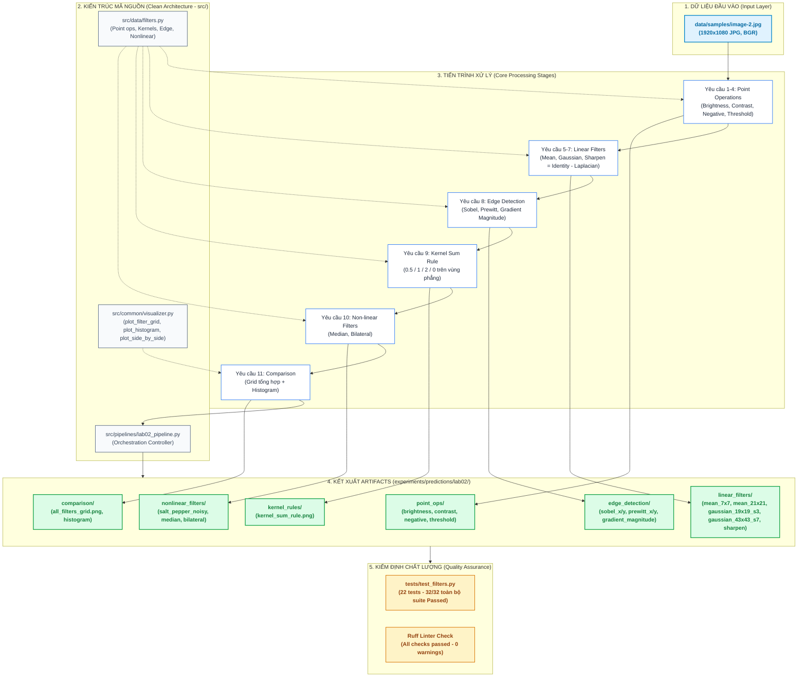

# BÁO CÁO KẾT QUẢ THỰC HÀNH LAB 2
## BÀI THỰC HÀNH CHƯƠNG 2: TOÁN TỬ ĐIỂM ẢNH & LỌC TUYẾN TÍNH

- **Môi trường**: Python 3.12.7 | OpenCV 5.0.0 | NumPy 2.2.6 | Matplotlib 3.11
- **Ảnh mẫu**: `data/samples/image-2.jpg` (1920 × 1080 JPG)

---

## 1. Mục Tiêu Bài Thực Hành

1. Hiểu và cài đặt các **toán tử điểm ảnh** (point operations): thay đổi độ sáng, độ tương phản, biến đổi âm bản, cắt ngưỡng.
2. Hiểu bản chất **phép tích chập (convolution)** trong ảnh số và cách kernel quyết định kết quả đầu ra.
3. Cài đặt và so sánh các **bộ lọc tuyến tính**: lọc trung bình, lọc Gaussian, làm nét.
4. Áp dụng các **bộ phát hiện biên** (Sobel, Prewitt) thông qua đạo hàm bậc 1.
5. Nắm **quy luật tổng hệ số kernel** và mối liên hệ giữa đạo hàm — kernel — hành vi bộ lọc.

---

## 2. Thiết Kế Kỹ Thuật & Cấu Trúc Mã Nguồn

### 2.1. Bảng Lộ Trình Thực Thi Chuẩn Hóa (Execution Roadmap)

| Step | Description | What it does | Import path |
| :---: | :--- | :--- | :--- |
| **1** | **Setup & Nạp ảnh** | Nạp thư viện, đọc ảnh mẫu BGR, tạo bản grayscale và cấu hình hiển thị inline | `—` |
| **2** | **Point Operations (YC1–4)** | Brightness `f+β`, Contrast `α·f`, Negative `255-f`, Threshold nhị phân | [`src/data/filters.py`](../../../src/data/filters.py) |
| **3** | **Linear Filters (YC5–7)** | Mean (box), Gaussian, Sharpen `Identity − Laplacian` | [`src/data/filters.py`](../../../src/data/filters.py) |
| **4** | **Edge Detection (YC8)** | Sobel X/Y, Prewitt X/Y, độ lớn gradient `√(Gx²+Gy²)` | [`src/data/filters.py`](../../../src/data/filters.py) |
| **5** | **Kernel Sum Rule (YC9)** | Kiểm chứng `output = c·Σkernel` với tổng `0.5 / 1 / 2 / 0` | [`src/data/filters.py`](../../../src/data/filters.py) |
| **6** | **Non-linear Filters (YC10)** | Median và Bilateral trên ảnh nhiễu muối tiêu | [`src/data/filters.py`](../../../src/data/filters.py) |
| **7** | **Comparison (YC11)** | Lưới so sánh tổng hợp toàn bộ bộ lọc | [`src/pipelines/lab02_pipeline.py`](../../../src/pipelines/lab02_pipeline.py) |

### 2.2. Sơ đồ Luồng Công Việc Trực quan (Visual Workflow Pipeline)



---

## 3. Nội Dung Chi Tiết & Kết Quả Thực Nghiệm

### 3.1. Yêu cầu 1: Thay Đổi Độ Sáng (Brightness)

- Công thức: `g(x, y) = f(x, y) + β` với `β = ±50`.
- Hiện tượng **bão hoà (clipping)**: dùng `np.clip` để cắt giá trị về `[0, 255]`, tránh tràn số `uint8`.
- Minh chứng: với `β = +50`, `min/max` chuyển thành `[50, 255]`; với `β = -50` thành `[0, 197]`.
- Artifact: `point_ops/brightness_plus50.jpg`, `point_ops/brightness_minus50.jpg`.

### 3.2. Yêu cầu 2: Thay Đổi Độ Tương Phản (Contrast)

- Công thức: `g(x, y) = α · f(x, y)` với `α ∈ {0.5, 1.8}`.
- `α = 0.5`: ảnh bạc màu (dải động co lại về phía giá trị trung bình).
- `α = 1.8`: ảnh tương phản mạnh hơn (dải động giãn ra).
- Artifact: `point_ops/contrast_0.5x.jpg`, `point_ops/contrast_1.8x.jpg`.

### 3.3. Yêu cầu 3: Biến Đổi Âm Bản (Negative)

- Công thức: `g(x, y) = 255 − f(x, y)` (với ảnh `uint8`).
- Ứng dụng: quan sát rõ chi tiết ở vùng tối của ảnh.
- Artifact: `point_ops/negative.jpg`.

### 3.4. Yêu cầu 4: Cắt Ngưỡng (Thresholding)

- Công thức: `g = 255` nếu `f > T`, ngược lại `g = 0`.
- **Vì sao chọn `T ∈ {80, 127, 180}`?**
  - `127` là **trung điểm** của dải cường độ `[0, 255]` — mốc "trung tính" để tham chiếu.
  - `80` và `180` lệch **±50** quanh trung điểm, đại diện cho ngưỡng **thấp** và **cao**.
  - Đây chỉ là 3 mốc **minh hoạ xu hướng** (`T` thấp → vùng trắng lớn; `T` cao → ít pixel vượt ngưỡng); đề bài chỉ yêu cầu "thử nhiều giá trị `T`", không ràng buộc con số cụ thể.
- Artifact: `point_ops/threshold_binary.png`.

### 3.5. Yêu cầu 5: Lọc Trung Bình (Mean Filter)

- Kernel toàn số dương, tổng = 1: 7×7 (`1/49` mỗi phần tử), 21×21 (`1/441`).
- `cv2.filter2D(image, -1, kernel)` cho kết quả tương đương `cv2.blur()`.
- Nhận xét: kernel càng lớn → mờ càng nhiều, mất chi tiết càng rõ. **Mean 21×21 gần như xoá sạch chi tiết nhỏ** (chỉ còn các mảng màu lớn), cho thấy rõ ảnh hưởng của kích thước kernel.
- Artifact: `linear_filters/mean_7x7.jpg`, `linear_filters/mean_21x21.jpg`.

### 3.6. Yêu cầu 6: Lọc Gaussian (Gaussian Filter)

- Kernel Gaussian: trọng số giảm dần theo khoảng cách tới tâm, tổng = 1.
- So với lọc trung bình: Gaussian **giữ cạnh tốt hơn** và mờ tự nhiên hơn (trọng số tâm lớn hơn biên).
- **Điều kiện kích thước kernel:** để Gaussian không bị **cắt cụt (truncated)**, cần `ksize ≈ 6σ + 1` (đủ ±3σ mỗi bên). Nếu ksize quá nhỏ so với σ (ví dụ σ=7 mà k=5) thì kernel bị cắt phẳng → **thoái hoá thành lọc trung bình**.
- Đối chiếu `cv2.GaussianBlur()` với `σ = 3.0` (k19) và `σ = 7.0` (k43): `σ` càng lớn → mờ càng mạnh.
- Artifact: `linear_filters/gaussian_19x19_s3.jpg`, `linear_filters/gaussian_43x43_s7.jpg`.

### 3.7. Yêu cầu 7: Làm Sắc Nét (Sharpening)

- **Bản chất:** làm nét = **Ảnh gốc + thành phần biên** = `Identity − Laplacian`.
- Kernel làm nét kinh điển (tâm dương lớn, xung quanh âm), **tổng = 1**:

  ```
  [ 0  -1   0]
  [-1   5  -1]
  [ 0  -1   0]
  ```
- **Phân biệt rõ (tránh nhầm lẫn):**
  - **Laplacian** `[0 1 0; 1 -4 1; 0 1 0]` có **tổng = 0** → là **bộ phát hiện biên**, KHÔNG phải bộ làm nét.
  - Muốn làm nét từ Laplacian: lấy `Ảnh gốc − Laplacian`.
  - Vì sao kernel làm nét có tổng = 1? Vì `Identity (tổng 1) − Laplacian (tổng 0) = tổng 1`.
- **Vai trò hệ số âm:** hệ số âm ở lân cận khuếch đại chênh lệch giữa tâm và vùng xung quanh → đường biên sắc hơn.
- Artifact: `linear_filters/sharpen.jpg`, `linear_filters/sharpen_comparison.png`.

### 3.8. Yêu cầu 8: Phát Hiện Cạnh Bằng Sobel & Prewitt

Đạo hàm bậc 1 theo hai phương, kernel **tổng = 0** nên triệt tiêu vùng phẳng và chỉ giữ lại biên.

- **Sobel** (nhấn mạnh hàng giữa):
  ```
  [-1  0  1]
  [-2  0  2]      →  tổng = 0
  [-1  0  1]
  ```
- **Prewitt** (hệ số đều, không nhấn mạnh hàng giữa):
  ```
  [-1  0  1]
  [-1  0  1]      →  tổng = 0
  [-1  0  1]
  ```
- **Sobel vs Prewitt — vì sao kết quả gần như giống nhau?**
  - Hai kernel **chỉ khác duy nhất ở trọng số hàng giữa** (`2` so với `1`); các hàng còn lại y hệt nhau.
  - Vì vậy **cấu trúc biên gần như trùng khớp**: hệ số tương quan giữa `Sobel|G|` và `Prewitt|G|` đo được **≈ 0.996**.
  - Khác biệt chủ yếu là **biên độ**: Sobel nhấn hàng giữa nên biên độ trung bình lớn hơn (≈ 39.5 so với ≈ 28.9, tức ~1.37×).
  - Sobel dùng trọng số `2` ở hàng giữa → **làm mịt nhẹ** theo phương vuông góc với hướng đạo hàm nên **ít nhạy nhiễu hơn**; Prewitt hệ số đều `1`, **đơn giản và tính nhanh hơn**.
  - Trên ảnh tổng thể, ảnh biên của hai phương pháp gần như trùng nhau; khác biệt chủ yếu thể hiện ở **biên độ**.
- **Độ lớn gradient tổng hợp:** `|G| = √(Gx² + Gy²)` (dùng `cv2.magnitude`) hiển thị ảnh biên tổng hợp cả hai hướng. Do `|G|` có giá trị lớn hơn 255, notebook **chuẩn hoá thang hiển thị theo percentile 99** để ảnh gradient không bị tối đen.
- Artifact: `edge_detection/sobel_x.png`, `sobel_y.png`, `prewitt_x.png`, `prewitt_y.png`, `sobel_gradient_magnitude.png`.

### 3.9. Yêu cầu 9: Tự Thiết Kế Kernel & Ý Nghĩa Tổng Hệ Số

Trên một vùng ảnh **phẳng** (mọi pixel = `c`), tích chập cho `output = c × (tổng hệ số kernel)`. Kiểm chứng với `c = 100`:

| Tổng kernel | Ý nghĩa | Output đo được | Kỳ vọng `c·Σkernel` |
| :---: | :--- | :---: | :---: |
| `0.5` | Giảm độ sáng / scale | 50 | 50 |
| `1.0` | Giữ nguyên độ sáng | 100 | 100 |
| `2.0` | Tăng độ sáng | 200 | 200 |
| `0.0` | Xoá vùng phẳng, chỉ giữ biên | 0 | 0 |

Trả lời các câu hỏi của đề bài:

1. **Vì sao tổng = 0 cho ra ảnh chỉ còn biên?** Trên vùng phẳng, `output = c · 0 = 0`, nên mọi vùng đồng nhất bị triệt tiêu; chỉ những vị trí có biến thiên (biên) mới cho giá trị khác 0.
2. **Vì sao tổng = 1 giữ nguyên độ sáng? Và vì sao tổng = 1 vẫn có thể là làm mờ?** Tổng = 1 bảo toàn giá trị trung bình nên độ sáng không đổi. Nhưng nếu mọi hệ số đều dương (mean, Gaussian), bộ lọc chỉ lấy trung bình có trọng số của lân cận → **làm mờ**, không làm nét.
3. **Điều kiện để kernel thực sự làm nét:** tổng = 1 **VÀ** có **hệ số âm**. Hệ số âm ở lân cận trừ bớt thành phần xung quanh, khuếch đại chênh lệch tâm–biên (high-pass) → tăng độ nét.

- **Lưu ý hiển thị:** vùng phẳng có mọi pixel bằng nhau (min = max), nên nếu để `imshow` tự co giãn thì mọi mức xám đều bị ánh xạ về **đen**. Vì vậy khi hiển thị phải **khoá thang màu cố định `[0, 255]`** để 4 mức `50 / 100 / 200 / 0` hiện ra khác nhau rõ ràng.
- **Áp lên ảnh thật:** cùng bộ kernel tự chế được áp lên **ảnh màu** (độc lập từng kênh B/G/R, đúng mô tả) để thấy tác dụng trực quan — `Σ=0.5` làm **tối**, `Σ=1.0` **giữ nguyên**, `Σ=2.0` **sáng hơn**, và `Σ=0.0` (Laplacian) chỉ còn **viền** (vùng phẳng bị triệt tiêu, chỉ giữ biên).
- Artifact: `kernel_rules/kernel_sum_rule.png`, `kernel_rules/kernel_effects_on_image.png`.

### 3.10. Yêu cầu 10: Lọc Phi Tuyến Tính (Non-linear Filters)

Cả hai bộ lọc được áp lên **cùng một ảnh đã thêm nhiễu muối tiêu (3%)** để so sánh công bằng:

- **Median** (`cv2.medianBlur`): thay mỗi pixel bằng **trung vị** vùng lân cận → rất hiệu quả với nhiễu muối tiêu vì **loại bỏ hẳn** các điểm nhiễu cực trị (0/255) ra khỏi trung vị.
- **Bilateral** (`cv2.bilateralFilter`): kết hợp thông tin **không gian** và **cường độ** → làm mờ vùng đồng nhất nhưng **giữ cạnh sắc nét**. Với nhiễu muối tiêu, bilateral chỉ giảm nhẹ vì đây là **trung bình có trọng số**, pixel nhiễu vẫn góp phần vào kết quả (không loại hẳn như trung vị) — minh hoạ rõ **hai bộ lọc phi tuyến có hành vi khác nhau**.
- **Vì sao không biểu diễn được bằng một kernel tích chập?** Vì kết quả đầu ra **không phải** tổ hợp tuyến tính có trọng số cố định của lân cận; trọng số của bilateral phụ thuộc chính giá trị pixel (phi tuyến), còn median là một thống kê thứ tự (order statistic).
- Artifact: `nonlinear_filters/salt_pepper_noisy.jpg`, `median_denoised.jpg`, `bilateral_filtered.jpg`.

### 3.11. Yêu cầu 11: So Sánh Tổng Hợp Các Bộ Lọc

| Bộ lọc | Loại | Tổng kernel | Làm mờ | Làm nét | Giữ cạnh | Khử nhiễu |
| :--- | :--- | :---: | :---: | :---: | :---: | :---: |
| Mean (box) | Tuyến tính | 1 | Cao | — | Kém | Trung bình |
| Gaussian | Tuyến tính | 1 | Trung bình | — | Khá | Trung bình |
| Sharpen | Tuyến tính | 1 | — | Cao | Tốt | — |
| Sobel | Tuyến tính | 0 | — | — | Tốt (biên) | — |
| Prewitt | Tuyến tính | 0 | — | — | Tốt (biên) | — |
| Median | Phi tuyến | — | — | — | Tốt | Rất tốt (muối tiêu) |
| Bilateral | Phi tuyến | — | Thấp | — | Rất tốt | Tốt |

- Artifact: `comparison/all_filters_grid.png`, `comparison/histogram_original.png`, `comparison/histogram_binary.png`.

---

## 4. Kiểm Thử & Kiểm Toán Chất Lượng (Quality Verification)

### 4.1. Unit Testing

- **Bộ kiểm thử**: `tests/test_filters.py` — 22 tests cho Lab 2.
- **Kết quả toàn bộ suite**: 32/32 Passed (bao gồm Lab 1).
- **Phạm vi kiểm thử**: point operations, kernel sum, mean/Gaussian/sharpen, Sobel/Prewitt, gradient magnitude, median/bilateral, noise generator, validators.

### 4.2. Code Quality & Linter

- **Ruff**: `python -m ruff check src tests` → `All checks passed!` (0 warning).
- **Tuân thủ quy chuẩn**: không dùng `print()` trong `src/`, dùng logger chuyên dụng; type hints và docstring đầy đủ.

### 4.3. Artifacts

Pipeline tạo thành công **19 image artifacts** trong `experiments/predictions/lab02/`.

---

## 5. Kết Luận

- **Tổng kernel = 1** ⇒ bảo toàn độ sáng (có thể là mờ hoặc nét tuỳ dấu hệ số).
- **Tổng kernel = 0** ⇒ triệt tiêu vùng phẳng, chỉ giữ biên (nhóm đạo hàm / phát hiện biên).
- Làm nét thật sự cần **tổng = 1 và có hệ số âm**; Laplacian (tổng = 0) là phát hiện biên, không phải làm nét.
- **Sobel** ít nhạy nhiễu hơn **Prewitt** nhờ trọng số hàng giữa bằng 2; nhưng do hai kernel chỉ khác nhau ở hàng giữa nên kết quả **gần như tương đương** (tương quan ≈ 0.996), chỉ khác biên độ.
- Lọc **phi tuyến** (median, bilateral) không biểu diễn được bằng một kernel tích chập.

---

## 6. Tài Liệu Tham Khảo (References & Technical Documentation)

### 6.1. Thư viện Cốt lõi & Tài liệu API Chính thức (Official Library Documentation)

1. **OpenCV (Open Source Computer Vision Library)**:
   - [Image Filtering (`imgproc` module)](https://docs.opencv.org/5.x/d4/d86/group__imgproc__filter.html): `cv2.filter2D`, `cv2.blur`, `cv2.GaussianBlur`, `cv2.medianBlur`, `cv2.bilateralFilter`, `cv2.Sobel`.
   - [Operations on Arrays](https://docs.opencv.org/5.x/d2/de8/group__core__array.html): `cv2.magnitude` tính độ lớn gradient.
2. **NumPy**:
   - [NumPy Broadcasting & Vectorization](https://numpy.org/doc/stable/user/basics.broadcasting.html): tính toán điểm ảnh 100% vector hoá thay cho vòng lặp.
   - [numpy.clip](https://numpy.org/doc/stable/reference/generated/numpy.clip.html): cắt biên giá trị điểm ảnh trong `[0, 255]`.
3. **Matplotlib**:
   - [Matplotlib Pyplot API](https://matplotlib.org/stable/api/pyplot_summary.html): hiển thị lưới ảnh so sánh và histogram.

### 6.2. Tiêu chuẩn Kỹ thuật & Giải thuật Nền tảng (Technical Standards & Algorithms)

1. **Gaussian Smoothing**: Gaussian kernel tách được (separable) thành tích ngoài của hai vector 1D, giảm độ phức tạp tính toán.
2. **Sobel & Prewitt Operators**: bộ xấp xỉ đạo hàm bậc 1 rời rạc, là nền tảng của phát hiện biên (Canny, Harris).
3. **Laplacian Operator**: xấp xỉ đạo hàm bậc 2 (toán tử vi phân), tổng kernel = 0; dùng cho case tổng = 0 ở YC9 và minh hoạ làm nét `Identity − Laplacian`.

### 6.3. Quy ước Thị giác Máy tính & Định dạng Dữ liệu (CV Conventions & Formats)

1. **Kernel Sum Convention**: tổng hệ số kernel quyết định hành vi bộ lọc — `0` (đạo hàm / biên), `1` (bảo toàn độ sáng).
2. **OpenCV BGR Legacy Layout**: ảnh mặc định của `cv2.imread()` ở thứ tự kênh BGR, cần đổi sang RGB để hiển thị đúng.

### 6.4. Liên kết Mã Nguồn Module Dự Án (Internal Project Links)

- [`src/data/filters.py`](../../../src/data/filters.py): Toán tử điểm ảnh, kernel tuyến tính, phát hiện biên, lọc phi tuyến.
- [`src/common/visualizer.py`](../../../src/common/visualizer.py): Bộ công cụ trực quan hoá (`plot_filter_grid`, `plot_histogram`, `plot_side_by_side`).
- [`src/pipelines/lab02_pipeline.py`](../../../src/pipelines/lab02_pipeline.py): Controller điều phối thực thi toàn bộ Lab 2.
- [`tests/test_filters.py`](../../../tests/test_filters.py): Bộ unit tests cho Lab 2.
