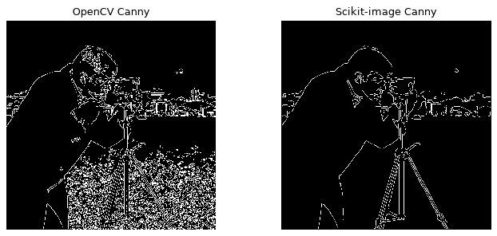
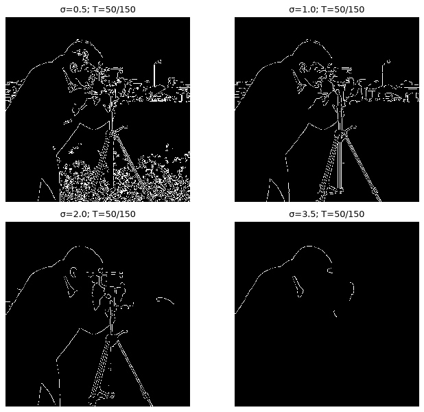
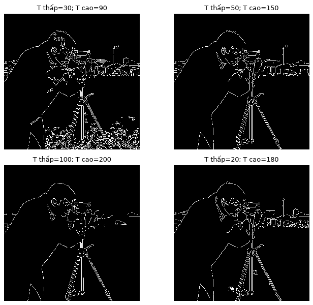
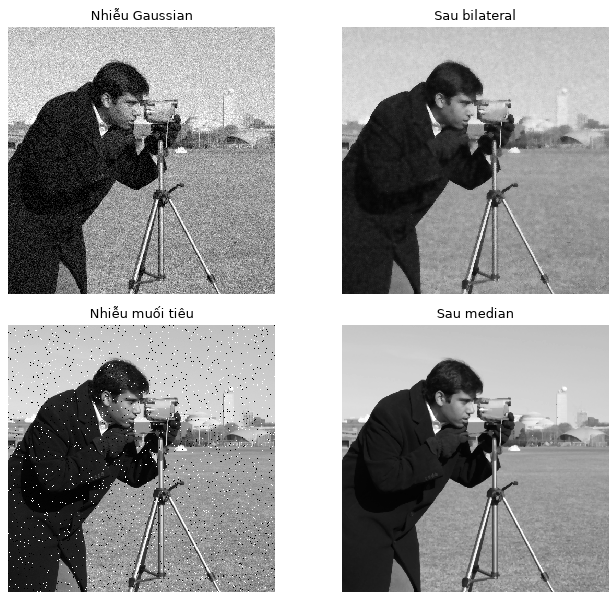
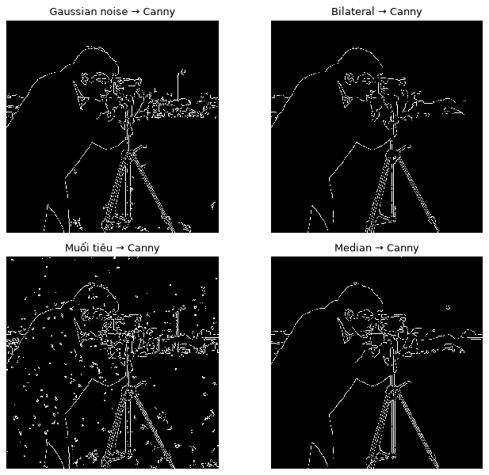
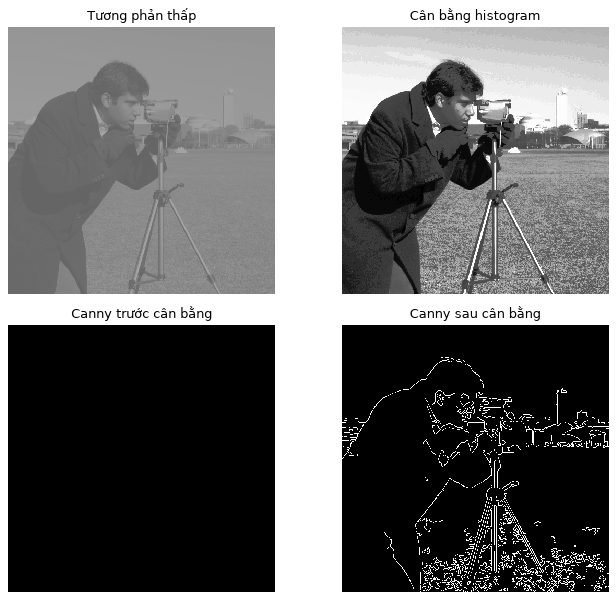
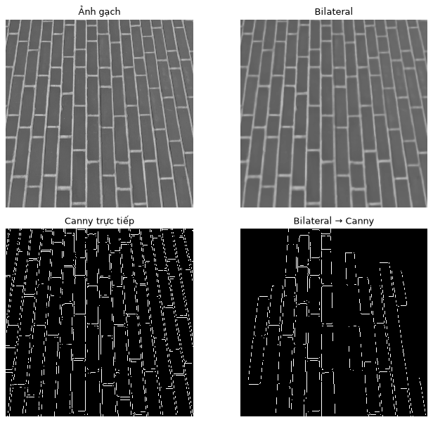
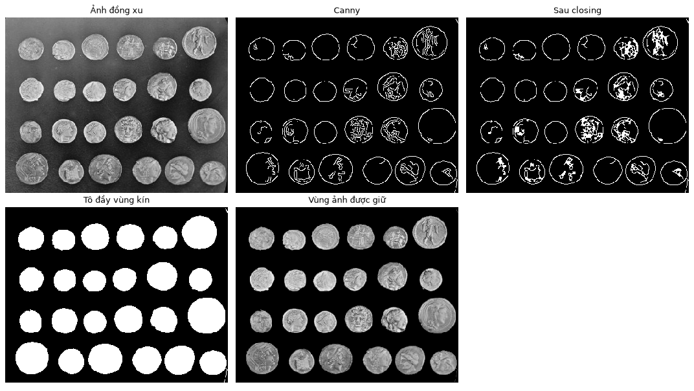
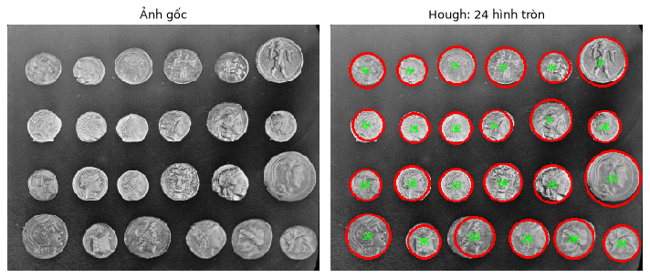

# BÁO CÁO LAB 03 — CANNY EDGE DETECTOR

Kiểm tra ngày 25/10/2026. [Notebook thực hành](../../../notebooks/labs/lab_03.ipynb) · [Đặc tả](LAB_03_DESCRIPTION.md) · [Cấu hình](../../../configs/experiment/lab03_canny.yaml).

## 1. Phạm vi và tái lập

Báo cáo phản ánh notebook hiện tại: hai thư viện Canny, khảo sát tham số, tiền xử lý, phân đoạn và nhận dạng hình tròn. Hình được trích từ output sau một lần chạy kernel mới. Không sử dụng số liệu của pipeline mở rộng cũ trong `src/pipelines/lab03_pipeline.py`.

Ảnh mẫu lấy từ `skimage.data`: camera và brick 512×512, coins 303×384. Ảnh xử lý là grayscale uint8; scikit-image nhận float [0,1], trả bool. Canvas vẽ hình tròn là RGB. Thực hành chạy CPU, không huấn luyện mô hình.

Seed nhiễu 42 dùng `np.random.default_rng`. Cấu hình tham chiếu: sigma=1, ngưỡng 50/150, Gaussian 7×7. YC2–4.1 dùng L2gradient=True; YC1 OpenCV giữ lời gọi đơn giản với mặc định của hàm. Hough có cấu hình riêng. Đây là tham số minh họa, không phải tối ưu cho mọi ảnh.

Cài `requirements/base.txt` cùng `jupyter nbclient nbformat ipykernel`, mở notebook rồi **Restart Kernel → Run All**. Sau khi đổi YAML phải chạy lại từ đầu. HTML nhúng hình để đọc độc lập; Markdown dùng ảnh trong `docs/assets/lab03/`.

Môi trường kiểm tra: Python 3.13.15, OpenCV 5.0.0, NumPy 2.5.3, SciPy 1.18.1, scikit-image 0.26.0. Dependencies đặt phiên bản tối thiểu nên môi trường khác có thể khác nhẹ kết quả.

### 1.1. Mục tiêu và cách tổ chức thí nghiệm

Bài thực hành trả lời bốn câu hỏi theo thứ tự: gọi Canny bằng thư viện thế nào; đổi tham số thì kết quả thay đổi ra sao; ảnh khó cần tiền xử lý gì; và làm thế nào dùng thông tin biên để hỗ trợ tìm vùng hoặc hình dạng. Mỗi yêu cầu có một mục tiêu riêng, vì vậy không dùng kết quả YC1 làm mốc trực tiếp cho mọi hình ở YC2–YC4.

YC1 minh họa cú pháp tối thiểu. YC2 giữ cố định ảnh và chỉ thay nhóm tham số đang khảo sát. YC3 tạo các tình huống ảnh khó rồi so sánh từng cặp trước/sau xử lý. YC4 chọn ảnh coins có các đối tượng gần tròn, tương đối tách rời để thấy rõ đầu ra vùng và đầu ra hình học.

Số pixel biên được đếm bằng số phần tử khác 0. Đại lượng này trả lời “có bao nhiêu điểm được giữ”, không trả lời “có bao nhiêu điểm đúng”. So sánh cùng ảnh/cấu hình giúp mô tả xu hướng; so sánh khác kích thước hoặc khác điều kiện xử lý cần thận trọng.

### 1.2. Dữ liệu vào và kết quả mong đợi

- **Camera:** ảnh tự nhiên có người, máy ảnh, giá đỡ và vùng nền, phù hợp xem cả viền lớn và chi tiết nhỏ.
- **Brick:** nhiều vân bề mặt xen với đường ron, phù hợp phân biệt cấu trúc cần giữ với texture.
- **Coins:** hình tròn tương đối rõ trên nền khác cường độ, phù hợp minh họa phân đoạn và Hough; đây vẫn là ảnh tự nhiên có hoa văn và ánh sáng không đều.

Bản đồ Canny chứa vị trí biên; mask phân đoạn chứa phần diện tích dự đoán; kết quả Hough là danh sách tâm và bán kính. Ba loại đầu ra này không thay thế nhau. Ví dụ, một mask trắng liền khối chưa có ID từng đồng xu, còn một vòng tròn Hough chưa cho biết vật đó có phải tiền thật hay không.

### 1.3. Đọc cấu hình đúng phạm vi

Notebook lấy `sigma`, hai ngưỡng và `aperture_size` từ `default_params`, nhưng lấy `l2_gradient` từ nhánh `notebook`. Tiền xử lý cũng lấy từ `notebook`, không lấy các thông số CLAHE/median của nhánh `preprocessing` cũ. YC4.1 dùng `segmentation`; YC4.2 dùng `shape_detection.hough_circles`.

Các nhánh `notebook.region_segmentation` và `notebook.top_hat_detection` còn trong YAML nhưng không được notebook hiện tại sử dụng. Sửa các giá trị đó sẽ không thay đổi kết quả YC4. Muốn chỉnh đúng, hãy xem tên biến cấu hình trong cell thực thi tương ứng.


## 2. Lý thuyết

### 2.1. Năm bước Canny

1. **Gaussian:** trọng số tỉ lệ với `exp(-(x²+y²)/(2σ²))`, giảm nhiễu trước khi xét biên. Sigma lớn làm mịn mạnh nhưng có thể xóa chi tiết.
2. **Gradient:** dùng thay đổi theo hai hướng Gx, Gy; độ lớn `sqrt(Gx²+Gy²)` và hướng `atan2(Gy,Gx)` mô tả cường độ và hướng biến đổi.
3. **Non-maximum suppression:** giữ cực đại dọc hướng gradient để làm mỏng ứng viên biên.
4. **Ngưỡng kép:** chia ứng viên thành mạnh, yếu và bị loại.
5. **Hysteresis:** giữ biên yếu nối được với biên mạnh, loại biên yếu cô lập.

Notebook gọi thư viện, không cài đặt lại năm bước. OpenCV được làm mịn Gaussian riêng ở YC2–4.1; scikit-image có sigma và làm mịn trong hàm canny.

### 2.1.1. Từ làm mịn đến biên mảnh

Gaussian là trung bình có trọng số: điểm gần tâm ảnh hưởng nhiều hơn điểm xa. Tổng trọng số được chuẩn hóa để vùng ảnh có cường độ đồng nhất không tự thay đổi mức sáng chỉ vì lọc. Trong bài, bán kính `ceil(3σ)` tạo một cửa sổ hữu hạn bao quanh phần lớn trọng số của Gaussian; đây là quy tắc chọn kích thước kernel, không phải chứng minh kernel đó tối ưu.

Sau bước làm mịn, một ranh giới có thể tạo phản hồi trên nhiều pixel lân cận. NMS nhằm giữ vị trí phản hồi lớn nhất theo hướng biến đổi. Ví dụ, nếu phản hồi dọc hướng so sánh là 20, 80, 35 thì vị trí 80 là ứng viên được giữ. NMS không có nhiệm vụ tô kín vật thể hay gán nhãn “người”, “đồng xu”.

Sau NMS vẫn cần quyết định ứng viên nào đủ tin cậy. Ngưỡng kép và hysteresis làm việc cùng nhau: một nét yếu có thể được giữ nếu nối tới nét mạnh, nhưng nét yếu cô lập có thể bị loại. Vì vậy hạ ngưỡng thấp không có nghĩa mọi nét yếu đều xuất hiện. Các giai đoạn này được giải thích trong [tài liệu Canny của OpenCV](https://docs.opencv.org/4.13.0/da/d22/tutorial_py_canny.html).

### 2.1.2. Ý nghĩa của sigma trong bài thực hành

Sigma điều khiển mức làm mịn, không trực tiếp là số pixel biên cần lấy. Với sigma nhỏ, nhiều chi tiết còn lại để Canny xem xét. Với sigma lớn, các biến đổi nhỏ bị làm yếu; ngay cả đường viền hữu ích cũng có thể biến mất. Chọn sigma phụ thuộc kích thước đối tượng cần quan sát và mức nhiễu.

Trong YC2, sigma 0.5, 1, 2, 3.5 tương ứng kernel 5×5, 7×7, 13×13, 23×23 theo quy tắc đã chọn. Vì kích thước kernel đi cùng sigma, thí nghiệm khảo sát mức làm mịn Gaussian với cửa sổ thích hợp, không phải giữ nguyên cửa sổ rồi chỉ đổi độ lệch chuẩn.

### 2.1.3. Ranh giới giữa giải thích và cài đặt

Phần lý thuyết giúp đọc ý nghĩa thuật toán; phần thực hành vẫn dùng API thư viện. Không cần thêm một pipeline Canny tự viết để đáp ứng YC1. Cũng không cần xuất ảnh Gx, Gy hay tự cài NMS trong notebook hiện tại. Sự phân chia này giữ notebook ngắn, còn report chịu trách nhiệm giải thích cơ chế và cách đọc kết quả.


### 2.2. So sánh và ứng dụng

Sobel dùng đạo hàm bậc nhất để quan sát thay đổi theo hướng, chưa có cơ chế ngưỡng kép và liên kết biên của Canny. Laplacian dùng đạo hàm bậc hai, nhạy nhiễu và thường cần tiền lọc. Canny thêm làm mỏng và hysteresis nên thường tốn xử lý hơn một phép lọc đạo hàm đơn lẻ; bài này không benchmark tốc độ.

Ưu điểm: biên mảnh, điều chỉnh được mức giữ chi tiết. Hạn chế: phụ thuộc nhiễu, tương phản và tham số; cạnh không tự mang nhãn đối tượng. Các ứng dụng gồm tìm đường viền sản phẩm, hỗ trợ đo hình học, tiền xử lý OCR hoặc phát hiện làn đường. Ví dụ luồng làn đường: ảnh → vùng quan tâm → Canny → Hough tìm đoạn thẳng; đây là minh họa lý thuyết, chưa triển khai.

### 2.3. Khi nào nên chọn Canny?

Nếu mục tiêu là bản đồ đường viền mảnh để quan sát hoặc đưa vào một bước hình học tiếp theo, Canny là lựa chọn phù hợp để thử. Nếu mục tiêu chỉ là mức biến đổi theo một hướng, phản hồi Sobel có thể đã đủ. Nếu mục tiêu là vùng có cùng màu, phân đoạn theo màu có thể trực tiếp hơn; nếu mục tiêu là tên đối tượng, cần bổ sung một phương pháp nhận dạng thích hợp.

Một ranh giới do bóng đổ, hoa văn hoặc phản xạ cũng có thể được Canny phát hiện. Đây không nhất thiết là lỗi của hàm: nó phát hiện thay đổi ảnh, còn người thiết kế phải xác định thay đổi nào phục vụ bài toán. Trên đồng xu, cả viền ngoài và hoa văn trong mặt xu đều có thể tạo cạnh, nhưng YC4 chủ yếu quan tâm viền ngoài.


## 3. Kết quả thực hành

### YC1 — Hai thư viện

OpenCV dùng `cv2.Canny(img, low, high)`. Scikit-image nhận ảnh float và ngưỡng low/255, high/255, sigma=1. Đổi thang ngưỡng không làm hai triển khai tương đương: bước làm mịn và xử lý bên trong khác nhau.

Số pixel biên là **30.980 (OpenCV)** và **7.554 (scikit-image)**. OpenCV giữ nhiều chi tiết hơn trong cấu hình đang chạy. Không kết luận thư viện nào chính xác hơn vì chưa đồng nhất điều kiện xử lý và không có nhãn chuẩn.



#### Triển khai và đọc kết quả YC1

Đoạn code dưới được lấy nguyên từ cell YC1 của notebook:

```python
edges_cv = cv2.Canny(img, low, high)
# Scikit-image dùng ảnh float [0, 1], nên đổi thang ảnh và ngưỡng.
edges_sk = feature.canny(
    util.img_as_float(img),
    sigma=sigma,
    low_threshold=low / 255,
    high_threshold=high / 255,
)
show_grid([edges_cv, edges_sk], ["OpenCV Canny", "Scikit-image Canny"], ncols=2)
```

Hai kết quả có cùng kích thước ảnh nhưng khác dtype. `util.img_as_float` chuẩn hóa ảnh trước khi gọi scikit-image. `low/255` và `high/255` là các ngưỡng được chọn trên thang ảnh đã đổi; chúng không phải bằng chứng hai bộ phát hiện đã được hiệu chỉnh tương đương. Tham số sigma và kiểu đầu ra được mô tả trong [API scikit-image Canny](https://scikit-image.org/docs/stable/api/skimage.feature.html#skimage.feature.canny).

Khi xem hình, nên nhìn lần lượt viền người, giá máy ảnh và các vùng có nhiều chi tiết. Kết quả OpenCV hiện tại dày đặc hơn về số lượng điểm biên; scikit-image lược bớt nhiều chi tiết. Không nên diễn đạt rằng OpenCV “nhiễu hơn” hoặc scikit-image “chính xác hơn” nếu chưa xác định các biên mong muốn và điều kiện so sánh.

**Kết luận YC1:** đã gọi và hiển thị được hai thư viện. Nếu muốn nghiên cứu so sánh công bằng hơn, cần đồng bộ tiền xử lý và cách chọn tham số; đó là thí nghiệm bổ sung, không phải kết quả đã có.


### YC2 — Sigma và ngưỡng

Giữ ngưỡng 50/150, sigma 0.5 → 1 → 2 → 3.5 cho số pixel biên **20.012 → 7.937 → 4.740 → 793**. Kernel có bán kính ceil(3σ), kích thước lẻ. Sigma lớn giảm texture nhưng cũng có thể mất biên cần giữ. Sigma=1 là mốc tham chiếu trong lưới.



Giữ sigma=1, các cặp ngưỡng cho kết quả:

- 30/90: **15.972** pixel, giữ nhiều chi tiết yếu.
- 50/150: **7.937** pixel, cấu hình tham chiếu.
- 100/200: **6.025** pixel, loại bớt chi tiết.
- 20/180: **8.483** pixel; biên yếu vẫn phải nối tới biên mạnh.

Các cặp này minh họa ảnh hưởng tham số, không chứng minh tỷ lệ nào tối ưu. 50/150 là cấu hình bài, không phải ngưỡng mặc định của OpenCV.



#### Thiết kế khảo sát và code YC2

Lưới sigma dùng cùng ảnh camera, cùng ngưỡng, cùng aperture và lựa chọn L2. Đây là điều kiện để quy sự khác biệt chủ yếu cho bước làm mịn.

```python
smoothed = cv2.GaussianBlur(img, (ksize, ksize), sigma)
sigma_images = []
sigmas = config["tuning_grid"]["sigmas"]
for value in sigmas:
    r = int(np.ceil(settings["gaussian_radius_sigmas"] * value))
    blurred = cv2.GaussianBlur(img, (2 * r + 1, 2 * r + 1), value)
    edges = cv2.Canny(blurred, low, high, apertureSize=aperture, L2gradient=l2_gradient)
    sigma_images.append(edges)
show_grid(sigma_images, [f"σ={value}; T={low}/{high}" for value in sigmas], ncols=2)
```

Lưới ngưỡng dùng chung biến `smoothed`. Việc chuẩn bị ảnh một lần giúp tránh trường hợp vô tình đổi cả độ mờ lẫn ngưỡng rồi không biết yếu tố nào gây khác biệt.

```python
threshold_images = []
pairs = list(config["tuning_grid"]["threshold_pairs"].values())
for t_low, t_high in pairs:
    edges = cv2.Canny(
        smoothed, t_low, t_high, apertureSize=aperture, L2gradient=l2_gradient
    )
    threshold_images.append(edges)
show_grid(threshold_images, [f"T thấp={a}; T cao={b}" for a, b in pairs], ncols=2)
```

**Lý do chọn dải khảo sát:** sigma trải từ nhẹ đến khá mạnh để hiệu ứng dễ thấy. Các cặp 30/90, 50/150, 100/200 cho ba mức chọn lọc; cặp 20/180 bổ sung trường hợp khoảng ngưỡng rộng. Chúng được chọn để minh họa hành vi, không thu được từ thuật toán tối ưu hóa hay đánh giá trên tập kiểm thử.

**Cách đọc hai lưới:** trước hết xác định đường viền mình muốn giữ, sau đó quan sát nó có liên tục không và những vùng nào sinh thêm nét không cần thiết. Không lấy số lượng pixel nhỏ nhất làm tiêu chí thắng. Sigma=3.5 chỉ còn 793 điểm biên là dấu hiệu cần kiểm tra việc mất cấu trúc, không phải bằng chứng khử nhiễu tốt nhất.

Ở cặp 20/180, số pixel lớn hơn cấu hình 50/150 dù ngưỡng cao lớn hơn. Điều này minh họa tác động kết hợp của cả hai ngưỡng: không thể chỉ nhìn một giá trị rồi suy ra chắc chắn tổng số biên. **Kết luận YC2:** cấu hình 1 và 50/150 là mốc để so sánh, chưa được chứng minh là tốt nhất.


### YC3 — Tiền xử lý

**Gaussian noise:** độ lệch chuẩn 20 trên thang 0–255, clip rồi ép uint8. Bilateral d=9, sigmaColor=50, sigmaSpace=5 đưa số pixel biên **9.003 → 5.938**. Cần kiểm tra cả mức giảm nhiễu và đường viền quan trọng bị mất.

**Muối tiêu:** khoảng 3% pixel được thay bằng 0/255. Median 3×3 đưa số pixel biên **13.201 → 6.963**. Không có phép đo chứng minh loại hết nhiễu. Mỗi cặp trước/sau đều qua cùng bước Gaussian và cùng cấu hình Canny.





**Tương phản thấp:** tạo bằng `100 + 0.25 × ảnh`, sau ép uint8 có khoảng 100–163. Dùng `cv2.equalizeHist` toàn cục. Số pixel biên **0 → 13.897**. Cân bằng giúp lộ lại thay đổi cường độ nhưng cũng có thể làm nhiễu/texture rõ hơn. Notebook không dùng CLAHE.



**Nhiều chi tiết:** ảnh brick qua bilateral cùng cấu hình, số pixel biên **18.750 → 9.319**. Quan sát đường ron còn liên tục và texture giảm tới đâu; ít biên hơn không tự động nghĩa là tốt hơn.



#### Cơ chế các bộ tiền xử lý

**Median** lấy trung vị của lân cận. Một pixel xung trắng/đen có thể bị thay bằng giá trị đại diện của vùng xung quanh, nên đây là lựa chọn hợp lý cho muối tiêu. Kernel 3×3 là cửa sổ nhỏ để hạn chế làm mất chi tiết; tăng kernel có thể làm sạch mạnh hơn nhưng cũng biến dạng nét nhỏ.

**Bilateral** dùng cả độ gần trong không gian lẫn độ giống về cường độ để gán trọng số. Hai điểm gần nhau nhưng chênh sáng lớn có thể ít ảnh hưởng lẫn nhau hơn so với lọc trung bình thông thường. Điều đó giúp hạn chế trộn qua ranh giới rõ, nhưng không đảm bảo mọi biên được bảo toàn.

Trong bài, d=9 giới hạn vùng lân cận, sigmaColor=50 điều khiển mức chấp nhận khác biệt cường độ, sigmaSpace=5 điều khiển ảnh hưởng khoảng cách. Đây là cấu hình thử giữ nguyên giữa hai tình huống dùng bilateral để người đọc theo dõi dễ hơn. Nó không được tuyên bố là phù hợp mọi loại nhiễu.

**Cân bằng histogram toàn cục** ánh xạ mức xám theo phân bố tích lũy. Có thể mô tả ánh xạ lý tưởng bằng `s(k) = (L−1) × Σ[j≤k] p(j)`, sau đó lượng tử hóa; chi tiết chuẩn hóa của triển khai cần theo hàm thư viện. Mục tiêu là sử dụng dải biểu diễn rộng hơn, không tái tạo thông tin đã mất do lượng tử hóa. Vì vậy ảnh sau cân bằng không nhất thiết giống ảnh camera ban đầu.

#### Code và tính công bằng của YC3

Cell tạo nhiễu và lọc:

```python
rng = np.random.default_rng(config["seed"])
gaussian_noisy = np.clip(
    img.astype(np.float32) + rng.normal(0, settings["noise_std"], img.shape), 0, 255
).astype(np.uint8)
salt_noisy = img.copy()
mask = rng.random(img.shape)
amount = settings["salt_pepper_amount"]
salt_noisy[mask < amount / 2] = 0
salt_noisy[mask > 1 - amount / 2] = 255
bilateral = cv2.bilateralFilter(gaussian_noisy, **settings["bilateral"])
median = cv2.medianBlur(salt_noisy, settings["median_ksize"])
show_grid(
    [gaussian_noisy, bilateral, salt_noisy, median],
    ["Nhiễu Gaussian", "Sau bilateral", "Nhiễu muối tiêu", "Sau median"],
    ncols=2,
)
```

Cell tương phản thấp:

```python
low_contrast = np.clip(
    settings["low_contrast_offset"]
    + settings["low_contrast_gain"] * img.astype(np.float32),
    0,
    255,
).astype(np.uint8)
equalized = cv2.equalizeHist(low_contrast)
contrast_edges = []
for image in [low_contrast, equalized]:
    blurred = cv2.GaussianBlur(image, (ksize, ksize), sigma)
    contrast_edges.append(
        cv2.Canny(blurred, low, high, apertureSize=aperture, L2gradient=l2_gradient)
    )
show_grid(
    [low_contrast, equalized, *contrast_edges],
    [
        "Tương phản thấp",
        "Cân bằng histogram",
        "Canny trước cân bằng",
        "Canny sau cân bằng",
    ],
    ncols=2,
)
```

Trong notebook, nhãn “Canny trực tiếp” ở YC3 có nghĩa là không có bước median/bilateral/equalizeHist bổ sung; ảnh vẫn qua Gaussian chung trước Canny. Nếu bỏ qua chi tiết này, người đọc có thể nhầm rằng thí nghiệm so sánh ảnh hoàn toàn chưa lọc với ảnh đã lọc.

Bộ sinh ngẫu nhiên được khởi tạo một lần trước hai loại nhiễu. Muốn tái lập đúng ảnh nhiễu cần chạy lại từ đầu, thay vì chạy lặp tùy ý một phần câu lệnh sử dụng rng. Clip bảo đảm dữ liệu không vượt khoảng 0–255 trước khi ép uint8; nếu ép kiểu trước clip có thể làm thay đổi giá trị theo cách không mong muốn.

**Đọc kết quả:** giảm điểm biên sau median/bilateral là phù hợp với việc giảm biến đổi nhỏ, nhưng cũng có thể bao gồm biên thật bị mất. Ảnh tương phản thấp từ 0 lên 13.897 điểm cho thấy cấu hình cố định rất nhạy với cách biểu diễn tương phản. Trên brick, cần xét riêng đường ron và vân mặt gạch, vì cả hai đều là thay đổi ảnh hợp lệ.

**Kết luận YC3:** chọn tiền xử lý theo dạng ảnh; không áp dụng mọi bộ lọc nối tiếp chỉ để có pipeline dài hơn. Báo cáo không đưa tỷ lệ “xóa sạch nhiễu” vì chưa có phép đối chiếu biên chuẩn.


### YC4.1 — Tìm vùng từ biên

**coins → Gaussian → Canny → closing → binary_fill_holes → mask → ảnh giữ lại bằng mask.**

Closing dùng ellipse 3×3 một lần để nối khe hở nhỏ. Tô đầy lấp vùng nền không còn nối ra biên ngoài ảnh, không tự biết đó là đồng xu. Mask có **41.111 pixel trắng**; đã kiểm tra shape, giá trị 0/255 và ảnh kết quả bằng 0 ngoài mask.

Các vùng đồng xu hiện rõ; biên hở có thể làm bỏ sót, nối nhầm biên có thể giữ vùng nền sai. Không có nhãn chuẩn để báo IoU hoặc khẳng định mọi pixel đều đúng.



#### Giải thích từng bước YC4.1

1. **Gaussian:** giảm hoa văn nhỏ và nhiễu trước khi trích biên.
2. **Canny:** tạo đường nét trắng trên nền đen, chưa phải mask diện tích đồng xu.
3. **Closing:** giãn rồi co với cùng phần tử cấu trúc, có thể nối khe hở nhỏ trong đường nét. Kernel nhỏ giúp hạn chế nối hai đồng xu gần nhau.
4. **Tô đầy:** đánh dấu phần bên trong đường bao kín. SciPy xét phần bù từ biên ngoài ảnh; phần không tiếp cận được được xem là lỗ cần lấp, theo [tài liệu binary_fill_holes](https://docs.scipy.org/doc/scipy/reference/generated/scipy.ndimage.binary_fill_holes.html).
5. **Áp mask:** giữ cường độ gốc tại pixel trắng, đưa vùng ngoài về 0. Bước này tạo ảnh minh họa dễ đọc, không làm mask đúng hơn.

Closing và tô đầy có nhiệm vụ khác nhau: nối khe hở nhỏ chưa đồng nghĩa lấp toàn bộ lòng vùng. Ngược lại, tô đầy không tự sửa một đường bao mở lớn. Thứ tự vì vậy có ý nghĩa.

```python
from scipy.ndimage import binary_fill_holes

region_image = data.coins()
region_smoothed = cv2.GaussianBlur(region_image, (ksize, ksize), sigma)
region_edges = cv2.Canny(
    region_smoothed, low, high, apertureSize=aperture, L2gradient=l2_gradient
)
segment_params = config["segmentation"]
region_kernel = cv2.getStructuringElement(
    cv2.MORPH_ELLIPSE, tuple(segment_params["morph_kernel_size"])
)
region_closed = cv2.morphologyEx(
    region_edges,
    cv2.MORPH_CLOSE,
    region_kernel,
    iterations=segment_params["closing_iterations"],
)
region_mask = binary_fill_holes(region_closed > 0).astype(np.uint8) * 255
region_result = cv2.bitwise_and(region_image, region_image, mask=region_mask)
show_grid(
    [region_image, region_edges, region_closed, region_mask, region_result],
    ["Ảnh đồng xu", "Canny", "Sau closing", "Tô đầy vùng kín", "Vùng ảnh được giữ"],
    ncols=3,
)
```

**Tình huống thất bại:** hai đồng xu chạm nhau có thể thành một vùng; đồng xu chạm mép ảnh có thể không được tô như một vùng kín; hoa văn tạo vòng kín cũng có thể giữ vùng ngoài mong muốn. Mask chưa có nhãn từng thành phần nên không thể lấy số pixel trắng chia một diện tích tùy ý để đếm vật.

**Vì sao giữ ảnh coins:** cùng ảnh giúp người đọc so sánh phần diện tích giữ lại ở YC4.1 với các vòng tròn ở YC4.2. Đổi sang cảnh đá tự nhiên làm giả định đường tròn kém phù hợp và đổi luôn mục tiêu hình học. Nếu muốn đổi mẫu, nên chọn ảnh có đường bao rõ, vật không che nhau và kích thước phù hợp cấu hình.

**Kết luận YC4.1:** đã minh họa kết hợp Canny với hình thái học và tô đầy để tìm vùng. Không cần tô màu đối tượng để đáp ứng mục tiêu này; mask và ảnh giữ lại đã thể hiện vùng dự đoán.


### YC4.2 — Hough tìm hình tròn

Cùng ảnh coins → Gaussian 9×9, sigma=2 → HoughCircles với HOUGH_GRADIENT. Hàm nhận ảnh xám và có gradient/Canny nội bộ; không truyền mask biên YC4.1 vào làm ảnh đầu vào.

- dp=1.2: tỉ lệ độ phân giải ảnh so với bộ tích lũy tâm.
- minDist=40: hạn chế các tâm trùng hoặc quá gần nhau.
- param1=100: ngưỡng cao Canny nội bộ.
- param2=25: ngưỡng chấp nhận tâm của phương pháp đang dùng.
- Bán kính 15–40 pixel: phù hợp kích thước đồng xu quan sát trong mẫu.

Kết quả **24 hình tròn**, phù hợp 24 đồng xu quan sát trên ảnh. Vòng đỏ là đường tròn dự đoán, dấu xanh là tâm. ID sắp theo y rồi x, không nhất thiết tăng trái→phải theo từng hàng. Không nhận biết mệnh giá hay xác nhận ngữ nghĩa tiền xu; chưa đo sai số tâm/bán kính bằng nhãn chuẩn.



#### Cơ chế và triển khai YC4.2

Một đường tròn được mô tả bởi `(x−a)² + (y−b)² = r²`, với tâm `(a,b)` và bán kính `r`. Ý tưởng Hough là tập hợp bằng chứng ảnh để tìm bộ tham số phù hợp; phương pháp gradient của OpenCV khai thác thông tin hướng biến đổi để hỗ trợ tìm tâm. Xem [Hough Circle Transform của OpenCV](https://docs.opencv.org/4.13.0/da/d53/tutorial_py_houghcircles.html).

Điểm khác với YC4.1 là đầu ra: cần một danh sách hình tròn thay vì mask kín. Hai nhánh dùng chung ảnh đầu vào nhưng không bắt buộc phải nối tuần tự. Canny trong nhánh Hough là bước bên trong hàm, không phải biến `region_edges` truyền sang.

```python
circle_params = config["shape_detection"]["hough_circles"]
circle_smoothed = cv2.GaussianBlur(
    region_image, tuple(circle_params["blur_ksize"]), circle_params["blur_sigma"]
)
circles = cv2.HoughCircles(
    circle_smoothed,
    cv2.HOUGH_GRADIENT,
    dp=circle_params["dp"],
    minDist=circle_params["min_dist"],
    param1=circle_params["param1"],
    param2=circle_params["param2"],
    minRadius=circle_params["min_radius"],
    maxRadius=circle_params["max_radius"],
)
circle_result = cv2.cvtColor(region_image, cv2.COLOR_GRAY2RGB)
circle_count = 0
if circles is not None:
    found_circles = np.rint(circles[0]).astype(int)
    found_circles = found_circles[
        np.lexsort((found_circles[:, 0], found_circles[:, 1]))
    ]
    circle_count = len(found_circles)
    for number, (x, y, r) in enumerate(found_circles, start=1):
        cv2.circle(circle_result, (x, y), r, (255, 0, 0), 2)
        cv2.circle(circle_result, (x, y), 2, (0, 255, 0), -1)
        cv2.putText(
            circle_result,
            str(number),
            (x - 8, y + 5),
            cv2.FONT_HERSHEY_SIMPLEX,
            0.45,
            (0, 255, 0),
            1,
            cv2.LINE_AA,
        )
print(f"Số hình tròn phát hiện được: {circle_count}")
show_grid(
    [region_image, circle_result],
    ["Ảnh gốc", f"Hough: {circle_count} hình tròn"],
    ncols=2,
)
```

Nhánh `if circles is not None` xử lý trường hợp không phát hiện được hình nào. Các tọa độ được làm tròn để vẽ; việc vẽ chỉ trực quan hóa kết quả, không tham gia quyết định phát hiện. Vòng lặp duyệt các hình tròn là lặp theo đối tượng, không phải lặp từng pixel ảnh.

**Tinh chỉnh có mục tiêu:** nếu có nhiều vòng trùng, xem minDist và param2; nếu bỏ sót xu nhỏ/lớn, kiểm tra khoảng bán kính trước. Nếu nhiều hoa văn mặt xu tạo ứng viên, xem mức làm mịn và ngưỡng. Mỗi lần nên đổi một nhóm thông số rồi kiểm tra ảnh, không chỉ tìm cấu hình in ra đúng số 24.

**Kiểm tra trực quan:** cần xem một vòng có bao quanh đúng một đồng xu không, có vòng nằm trên nền không, có hai vòng cùng bao một đồng xu không và có vật chưa được đánh dấu không. Tổng số đúng vẫn có thể che giấu một phát hiện thiếu cộng với một phát hiện thừa. Sự phù hợp số lượng trong mẫu hiện tại chưa chứng minh khả năng tổng quát sang ảnh khác.

**Kết luận YC4.2:** Hough cung cấp mô hình hình tròn và vị trí để đánh dấu từng ứng viên. Top-hat chỉ làm nổi chi tiết theo cấu trúc lọc, K-means chỉ gom nhóm đặc trưng; riêng chúng không cho quyết định “đây là hình tròn” theo mô hình đang sử dụng.


## 4. Câu hỏi mở rộng

Phần này thảo luận phương pháp, không phải kết quả đã chạy trong notebook.

### 4.1. Đánh giá cạnh thế nào?

Định tính: xem độ liên tục, biên giả, biên bỏ sót và độ lệch vị trí. Có nhãn thì tính precision=TP/(TP+FP), recall=TP/(TP+FN), F1=2PR/(P+R); thống nhất dung sai khoảng cách, cách ghép biên và xử lý mẫu số bằng 0. Pratt FOM phạt khoảng cách từ biên dự đoán đến biên chuẩn; Hausdorff đo sai lệch xa nhất và nhạy với ngoại lai. Phải quy định trường hợp tập biên rỗng.

Bài này chỉ có số pixel biên và quan sát ảnh, chưa có F1/IoU. Số lượng biên không đo độ chính xác.

### 4.2. Cải thiện chất lượng và tốc độ?

Chọn lọc phù hợp nhiễu, vùng quan tâm, sigma và ngưỡng. Median/Otsu có thể gợi ý ngưỡng tự động như heuristic, không đảm bảo tối ưu cho Canny. Muốn kết luận tốc độ phải đo cùng kích thước ảnh/phần cứng; GPU cần tính cả chi phí truyền dữ liệu. Chưa benchmark CUDA nên không báo FPS.

### 4.3. Canny cho ảnh màu?

Đổi grayscale là cách đơn giản nhưng có thể mất ranh giới hai màu có mức xám gần nhau. Có thể chạy từng kênh rồi OR; cách này có thể tăng nhiễu hoặc làm dày biên. Gradient màu như Di Zenzo xét thay đổi đồng thời các kênh, là hướng mở rộng chưa thực hiện trong notebook.

### 4.4. Canny cho video?

Đọc frame → grayscale → làm mịn → Canny → hiển thị/ghi kết quả. Kiểm tra đọc frame thành công, dừng ở cuối video hoặc theo yêu cầu, giải phóng VideoCapture. Làm mượt theo thời gian có thể giảm nhấp nháy nhưng gây trễ/bóng mờ khi vật di chuyển. Chưa chạy video nên không có số liệu FPS hoặc mức giảm nhấp nháy.

### 4.5. Thiết kế đánh giá định lượng nếu mở rộng bài

Trước hết cần gán nhãn đúng loại đầu ra. Đánh giá biên dùng tập điểm biên chuẩn; đánh giá phân đoạn dùng mask vùng; đánh giá phát hiện hình tròn cần tâm/bán kính hoặc quy tắc ghép từng đối tượng. Không dùng nhãn của một loại đầu ra để kết luận trực tiếp chất lượng loại khác.

Với mask, có thể dùng `IoU = |M ∩ G| / |M ∪ G|`, trong đó M là dự đoán và G là nhãn chuẩn. Với đường tròn, có thể đặt điều kiện khoảng cách tâm và độ lệch bán kính trước khi ghép, rồi đếm phát hiện đúng/thừa/thiếu. Ngưỡng ghép phải được công bố trước khi nhìn kết quả, tránh chọn tiêu chí chỉ để tăng điểm.

Nếu có nhiều ảnh, nên dùng một nhóm để tinh chỉnh tham số và một nhóm riêng để đánh giá cuối. Việc chỉnh trên đúng một ảnh coins rồi báo kết quả trên chính ảnh đó chỉ chứng minh khả năng minh họa trên mẫu, không phải đánh giá tổng quát hóa. Các bước này là đề xuất cho nghiên cứu tiếp, chưa được thực hiện trong notebook.

### 4.6. Cách trả lời khi trình bày bài

- **“Vì sao không chỉ dùng Canny để tìm đối tượng?”** Vì bản đồ biên chỉ có đường nét; cần giả định hoặc kỹ thuật bổ sung để chuyển thành vùng/hình học.
- **“Vì sao cần closing trước khi tô đầy?”** Để sửa khe hở nhỏ; đường bao còn mở có thể không tạo lỗ kín để lấp.
- **“Hough có nhận dạng tiền xu không?”** Hough tìm cấu trúc hình tròn; tên tiền xu đến từ việc quan sát ngữ cảnh ảnh, không phải nhãn do thuật toán suy ra.
- **“Tại sao tham số này đúng?”** Chúng phù hợp để minh họa trên mẫu đã chọn; muốn nói tối ưu cần tiêu chí và tập đánh giá.
- **“Có nhiều biên hơn là tốt hơn không?”** Không; nhiều hơn có thể là chi tiết cần giữ hoặc nhiễu/texture ngoài mục tiêu.
- **“Tại sao chỉnh một giá trị YAML mà không đổi hình?”** Có thể sửa nhánh không được notebook dùng hoặc chưa chạy lại cell nạp cấu hình và các cell phụ thuộc.


## 5. Audit và trạng thái

- **Kiến trúc:** notebook gọi trực tiếp thư viện theo phạm vi học; tham số thí nghiệm nằm trong YAML; hình báo cáo lấy từ output thật.
- **Bám yêu cầu:** YC1–4 khớp description hiện tại; Hough là phương pháp bổ sung, không gán cho Chương 2. Không thêm demo tự cài đặt Canny vào notebook.
- **Quy chuẩn:** đường dẫn tương đối; helper có type hints/docstring; không lặp pixel; RGB tường minh; seed nhiễu cố định. Quy tắc GPU không áp dụng cho bài CPU.
- **Thực thi:** kernel mới chạy hết notebook, không lỗi; kiểm tra mask và 24 hình tròn đạt.
- **Hồi quy:** smoke 3/3, normal 8/8. Tests module cũ không thay thế việc chạy notebook.
- **Lint/format:** Ruff src/tests và notebook đạt; Black kiểm tra 19 file đạt.
- **Giới hạn:** pipeline mở rộng cũ còn tham số viết trực tiếp, CLAHE và ảnh tự tạo; chưa refactor toàn bộ pipeline đó. README chỉ rõ nó không tạo report hiện tại. Không tuyên bố toàn bộ code cũ tuân thủ mọi rule chỉ vì tests đạt.

Trạng thái đối chiếu notebook–description–report: **Done**. Thay đổi còn ở working tree, chưa commit/push.

## 6. Kết luận

Sigma, ngưỡng và tiền xử lý thay đổi rõ bản đồ biên. Closing và tô đầy chuyển biên kín thành vùng; Hough bổ sung phát hiện hình tròn. Cần phân biệt vùng ảnh, hình học và nhãn ngữ nghĩa để diễn giải kết quả đúng phạm vi.


## 7. Tài liệu đối chiếu

Các liên kết dưới hỗ trợ giải thích API và được đối chiếu khi cập nhật report. Phiên bản tài liệu online có thể khác môi trường thực thi đã ghi ở mục 1.

1. [OpenCV — Canny Edge Detection](https://docs.opencv.org/4.13.0/da/d22/tutorial_py_canny.html): các bước và giao diện Canny.
2. [scikit-image — feature.canny](https://scikit-image.org/docs/stable/api/skimage.feature.html#skimage.feature.canny): sigma, ngưỡng, dữ liệu vào và mask đầu ra.
3. [SciPy — binary_fill_holes](https://docs.scipy.org/doc/scipy/reference/generated/scipy.ndimage.binary_fill_holes.html): nguyên lý tô đầy và ảnh hưởng liên thông.
4. [OpenCV — Hough Circle Transform](https://docs.opencv.org/4.13.0/da/d53/tutorial_py_houghcircles.html): biểu diễn đường tròn và ví dụ sử dụng HoughCircles.
5. [Notebook của bài](../../../notebooks/labs/lab_03.ipynb): nguồn code và hình kết quả được báo cáo; đây là căn cứ cho số liệu thực nghiệm trong tài liệu này.
