# BÁO CÁO LAB 04 — SO SÁNH ẢNH BẰNG WAVELET HASH

Ngày chạy và kiểm tra: 26/10/2026. [Notebook](../../../notebooks/labs/lab_04.ipynb) · [Description](LAB_04_DESCRIPTION.md) · [Dữ liệu](LAB_04_DATASET.md) · [Số liệu chi tiết](../../assets/lab04/results.json).

## 1. Mục tiêu và phạm vi

Theo trang 16 của Chapter 3 Part 1, phần cơ bản gồm chuẩn bị dữ liệu, biến đổi Wavelet, lượng tử hóa/tạo mã băm, so sánh Hamming và đánh giá Accuracy, Recall, Specificity, ROC. Hai bài nâng cao là khảo sát phương pháp băm Wavelet và xây dựng ứng dụng tìm kiếm ảnh. Trang 17–18 là giải thích và khung code tham khảo, chưa định nghĩa hoàn chỉnh baseline RGB–LL–median–192 bit.

Bài làm chọn baseline đó làm cấu hình tham chiếu của project. Notebook trình bày trực tiếp dữ liệu và kết quả, dùng các hàm tính toán trong `src/` để tái sử dụng. Hình và số liệu trong report được lấy từ một lần thực thi sạch của notebook, không lấy từ report hoặc pipeline mẫu cũ.

Đã thực hiện phần cơ bản và hai bài nâng cao. Khảo sát độ bền là bổ sung, giới hạn ở các phép biến đổi được mô tả bên dưới. So sánh aHash/dHash/pHash, PR curve và ứng dụng tìm kiếm quy mô lớn chưa được triển khai ở notebook này; các câu hỏi liên quan được thảo luận riêng.

### 1.1. Môi trường và tái lập

Môi trường thực thi: python 3.13.15, opencv 5.0.0, numpy 2.5.3, pywavelets 1.8.0, scipy 1.18.1, sklearn 1.9.1. Tất cả chạy CPU.

Cài `requirements/base.txt` và `jupyter nbformat nbclient ipykernel markdown`. Từ thư mục project, chạy `python -m src.data.lab04_pairs` để tạo dữ liệu từ 26 ảnh đã cung cấp, rồi mở notebook và chọn **Restart Kernel → Run All**. Có thể dùng `python scripts/lab04/run_notebook.py` để chạy và xuất hình/số liệu. Report Markdown là nguồn chỉnh sửa báo cáo; `python scripts/lab04/render_report.py` xuất bản HTML tương ứng. Lần chạy notebook không tự sửa ảnh nguồn hoặc tự thay dữ liệu khi thiếu CSV.

Seed 42 được dùng khi chia nguồn và sinh nhiễu. Cấu hình dữ liệu ở `configs/dataset/lab04_pairs.yaml`; cấu hình hash/notebook ở `configs/experiment/lab04_wavelet.yaml`. Dependencies đặt phiên bản tối thiểu, nên cần ghi lại môi trường nếu kết quả khác. Thời gian xử lý bên dưới là một lần đo trên các ảnh đã nạp vào RAM, không gồm đọc file.

### 1.2. Đối chiếu cấu trúc bài làm

- **YC1:** nạp ảnh/cặp có nhãn, xem Wavelet, lượng tử hóa và tạo mã.
- **YC2:** Hamming từng cặp; heatmap giữa ảnh nguồn là phần trình bày bổ sung.
- **YC3:** khảo sát độ bền trên calibration, không dùng để chọn lại dữ liệu evaluation.
- **YC4:** chọn ngưỡng bằng calibration rồi chấm evaluation; ROC dùng điểm âm của khoảng cách.
- **Nâng cao 1:** thay sóng mẹ, mức phân rã và cách tạo bit, giữ nguyên bộ cặp.
- **Nâng cao 2:** tìm Top-3 ảnh nguồn với ảnh truy vấn JPEG; có thể đổi đường dẫn truy vấn trong notebook.

## 2. Dữ liệu và cách hiểu nhãn

### 2.1. Ảnh nguồn

Người học cung cấp 26 ảnh: Chihuahua–muffin gồm 7 chó và 7 muffin; mèo–kem gồm 6 mèo và 6 kem. Hai ảnh tập thể đã được loại bỏ và ảnh có watermark đã được chỉnh trước khi chuẩn bị dữ liệu. Đây là ảnh riêng từng ô, không phải một ảnh ghép hai đối tượng.

Ảnh chó/bánh khoảng 141×141, ảnh mèo/kem khoảng 196×196; resize về 256×256 chỉ để chuẩn hóa đầu vào, không tạo thêm chi tiết thật. Ảnh đã cắt/nén có thể mất thông tin. Tên tác giả, URL gốc và cá thể động vật chưa có metadata đầy đủ, vì vậy chưa xác nhận được sự độc lập theo nguồn website hoặc cá thể.

### 2.2. Nhãn tương tự và không tương tự

Nhãn **1** có nghĩa hai ảnh cùng ảnh nguồn: bản gốc và bản chỉnh sáng, tối, nhiễu hoặc JPEG. Nhãn **0** là hai ảnh gốc khác loại đối tượng trong cùng chủ đề: chó–muffin, mèo–kem. Không gán nhãn bằng khoảng cách Hamming và không coi mọi ảnh chó với nhau là cặp dương.

Các cặp khác đối tượng có thể giống hình thức. Nếu hash trả khoảng cách nhỏ cho chó và muffin, đó là kết quả của đặc trưng cảm nhận; bài đánh giá sẽ xem nó là phát hiện nhầm theo tiêu chí cùng nguồn. Hai cách hiểu “giống hình thức” và “cùng ảnh nguồn” phải được phân biệt khi trình bày kết quả.

### 2.3. Biến thể và chia nhóm

Mỗi ảnh nguồn tạo bốn biến thể: sáng ×1.3, tối ×0.7, nhiễu Gaussian σ=10 trên thang 0–255 và JPEG Q=50. Có 104 biến thể, tổng 130 ảnh tính cả nguồn. Biến thể giữ kích thước gốc và lưu RGB uint8. Notebook giữ RGB cả khi hiển thị và tính baseline hash; ảnh xám chỉ dùng cho phương pháp đối chiếu.

Chọn ngẫu nhiên 3 ảnh mỗi loại cho calibration bằng seed 42, giữ mọi biến thể cùng nhóm với ảnh nguồn. Nhóm calibration có 12 nguồn, 48 cặp dương và 18 cặp âm (66 cặp). Nhóm evaluation có 14 nguồn, 56 cặp dương và 25 cặp âm (81 cặp). Tổng 147 cặp; không có ảnh nguồn dùng ở cả hai nhóm.

Cặp âm gồm tất cả tổ hợp khác loại trong từng chủ đề/split, mỗi cặp một lần. Hai nhãn không cân bằng; các cặp cùng sử dụng ảnh nên không phải 147 quan sát độc lập. Việc tách nguồn giúp giảm rò rỉ do biến thể, nhưng chưa giải quyết được khả năng gần trùng hoặc cùng cá thể giữa các ảnh gốc khác file.

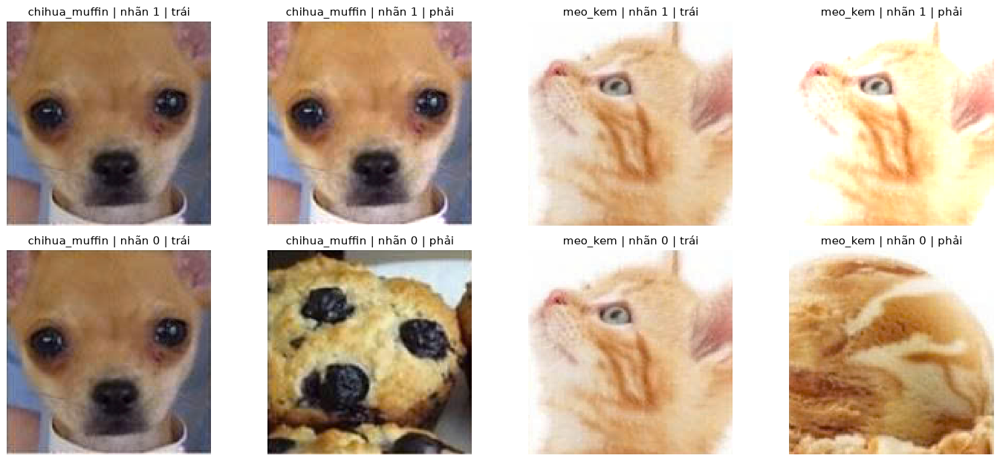

*Hình 1. Ví dụ cặp nhãn 1 và 0 trong calibration, hiển thị bằng màu gốc RGB.*

## 3. Cơ sở lý thuyết và thiết kế hash

### 3.1. Biến đổi Wavelet hai chiều

DWT dùng các bộ lọc thông thấp/thông cao và lấy mẫu để biểu diễn ảnh theo các mức phân giải. Thành phần xấp xỉ giữ cấu trúc tổng thể; các thành phần chi tiết mô tả biến đổi theo những hướng khác nhau. Với phân rã đa mức, tiếp tục phân tích thành phần xấp xỉ của mức trước.

`pywt.wavedec2` trả danh sách `[cA_n, (cH_n,cV_n,cD_n), ..., (cH_1,cV_1,cD_1)]`. Phải phân biệt ma trận đầu với tuple chi tiết khi duyệt. Baseline lấy `cA_n`, gọi là LL. Cấu trúc đầu ra được mô tả trong [tài liệu PyWavelets](https://pywavelets.readthedocs.io/en/latest/ref/2d-dwt-and-idwt.html).

Chế độ biên `symmetric` mở rộng dữ liệu đối xứng ở biên trước khi lọc. Kích thước hệ số phụ thuộc độ dài bộ lọc, kích thước ảnh, mức phân rã và chế độ biên; không suy ra LL 8×8 chỉ từ `level=1`. Các tên hướng phụ thuộc quy ước trục của thư viện; notebook dùng tên `cH`, `cV`, `cD` để tránh lẫn hướng ảnh và hướng ma trận.

Wavelet cung cấp thông tin ở các vị trí và mức phân giải. Không kết luận Wavelet luôn vượt Fourier/DCT; chọn biểu diễn phải được đánh giá trên mục tiêu và dữ liệu. Trong bài này chỉ khảo sát các phương pháp dựa trên Wavelet.

### 3.2. Lượng tử hóa và mã RGB 192 bit

Baseline tách ảnh RGB thành ba kênh. Mỗi kênh được chuẩn hóa float32 [0,1], resize 256×256 bằng INTER_AREA, phân rã db4 level=1, lấy LL rồi thu về 8×8 bằng INTER_AREA. Trung vị `m_c` tính trên 64 hệ số của chính kênh `c`; mỗi phần tử tạo bit `h_c[i,j] = 1 nếu LL_c,8[i,j] > m_c, ngược lại 0`. Làm phẳng từng ma trận và ghép R|G|B cho vector uint8 `(192,)`. Không chuyển grayscale trong baseline.

Median chia hệ số theo thứ tự tương đối trong từng kênh. Khi cường độ thay đổi tuyến tính đồng đều mà không clip/lượng tử hóa, thứ tự có thể giữ nên mã ổn định; ảnh thực có clip, lượng tử hóa và sai số nên không được coi bất biến tuyệt đối. Các giá trị bằng median gán 0; ảnh hằng có thể tạo mã ít hoặc không có bit 1. Không bắt buộc đúng 32 bit 1 cho mỗi kênh.

192 bit tương đương 24 byte nếu được đóng gói bit. NumPy uint8 dùng 192 byte cho 192 phần tử, chưa kể metadata; code hiện tại dùng dạng này để dễ đọc. Mã hữu hạn có thể va chạm, nên Hamming=0 không chứng minh hai file giống hệt nhau.

`bits=8` là cạnh ma trận *mỗi kênh* theo giao diện project; slide 18 chưa giải thích đầy đủ tham số này. Việc chọn RGB, LL, median riêng từng kênh, 8×8 và mã 192 bit là quyết định của bài làm. Median từng kênh chủ yếu giữ bố cục tương đối trong kênh, không bảo đảm mô tả màu sắc giống cách mắt người cảm nhận.

### 3.3. Biến thể bước nhảy theo ý tưởng slide 17

Code slide có lời gọi `pywt.quantize` và thao tác làm phẳng chưa xử lý tuple. Bản triển khai thay bằng quy tắc được công bố: ảnh xám float32 trên thang 0–255, resize 256×256, db4 level=3, symmetric; với mỗi hệ số c, tính `q=rint(c/2)` rồi bit `q % 2`. Ghép ma trận xấp xỉ trước, sau đó từng bộ chi tiết theo thứ tự mức trả về của PyWavelets.

Đây là một cách hiện thực hóa ý tưởng lượng tử hóa/tạo bit, không khẳng định slide đã quy định phép làm tròn đó. Modulo 2 giữ tính chẵn/lẻ của hệ số lượng tử hóa; thay đổi cường độ có thể làm đổi parity ở nhiều vị trí. Bản xám này là đối chiếu bổ sung, không phải baseline màu.

### 3.4. Khoảng cách Hamming và quyết định

Với hai vector nhị phân cùng độ dài B, `D_H = Σ[k=1..B] (h1[k] XOR h2[k])`, và khoảng cách chuẩn hóa `d_H = D_H/B`. Độ tương đồng quy ước có thể viết `1−d_H`, nhưng không phải xác suất hai ảnh cùng nguồn.

Quyết định tương tự khi `D_H ≤ τ`, còn lại không tương tự. Ngưỡng nhỏ giảm phát hiện nhầm nhưng có thể bỏ sót biến thể. Trước khi so sánh, code kiểm tra mã không rỗng, một chiều, nhị phân và cùng độ dài, tránh `zip` bỏ qua phần dư hoặc ép uint8 làm mất dữ liệu không hợp lệ.

### 3.5. Các chỉ số đánh giá

- TP: cặp cùng nguồn được dự đoán tương tự; FN: cặp cùng nguồn bị bỏ sót.
- TN: cặp khác loại được dự đoán khác; FP: cặp khác loại bị dự đoán tương tự.
- `Accuracy=(TP+TN)/(TP+TN+FP+FN)`.
- `Recall=TP/(TP+FN)`; `Specificity=TN/(TN+FP)`.
- Bổ sung: `Precision=TP/(TP+FP)` và `F1=2×Precision×Recall/(Precision+Recall)`; quy ước 0 khi không có dự đoán dương.

ROC biểu diễn TPR theo FPR khi quét ngưỡng. Điểm lớn phải ứng với lớp dương nên dùng `-distance`, không truyền nguyên khoảng cách theo chiều ngược. AUC đánh giá thứ hạng trên nhiều ngưỡng, khác Accuracy ở một ngưỡng. Thư viện yêu cầu dữ liệu có cả hai lớp trong cách đánh giá đang dùng; xem [roc_curve của scikit-learn](https://scikit-learn.org/stable/modules/generated/sklearn.metrics.roc_curve.html).

## 4. Kết quả từng yêu cầu

### 4.1. YC1 — Biến đổi và tạo mã

Minh họa các bước trên một ảnh nguồn. Đây là phần code notebook; hàm trong src thực hiện lại cùng quy tắc để dùng cho tất cả ảnh:

```python
demo_id = sources[settings["detail_source_index"]]["source_id"]
demo_rgb = rgb_images[demo_id]
channel_steps = {}
for channel, name in enumerate("RGB"):
    prepared = cv2.resize(
        demo_rgb[:, :, channel].astype(np.float32) / 255,
        tuple(params["image_size"]),
        interpolation=cv2.INTER_AREA,
    )
    coefficients = pywt.wavedec2(
        prepared, params["wavelet"], mode="symmetric", level=params["level"]
    )
    ll = coefficients[0]
    ll_small = cv2.resize(
        ll, (params["bits"], params["bits"]), interpolation=cv2.INTER_AREA
    )
    bit_matrix = (ll_small > np.median(ll_small)).astype(np.uint8)
    channel_steps[name] = (prepared, ll, ll_small, bit_matrix)
demo_hash = np.concatenate([channel_steps[name][3].ravel() for name in "RGB"])
print(
    f"Ảnh: {demo_id}; mỗi LL: {channel_steps['R'][1].shape}; mã RGB: {demo_hash.shape}, {demo_hash.dtype}"
)
for name in "RGB":
    print(f"{name}: {''.join(map(str, channel_steps[name][3].ravel()))}")
visual.plot_hash_steps(demo_rgb, channel_steps)
```

Mỗi LL của ảnh minh họa có kích thước **131×131**, sau chuẩn hóa còn 8×8. Mã R|G|B dài **192 bit**; từng đoạn 64 bit được in trong notebook.

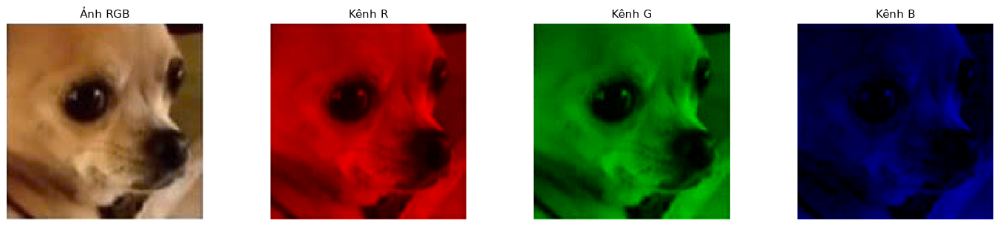

*Hình 2. Ảnh màu gốc và từng kênh R, G, B được tô bằng màu tương ứng; vùng đen là hai kênh còn lại đã tắt để minh họa.*

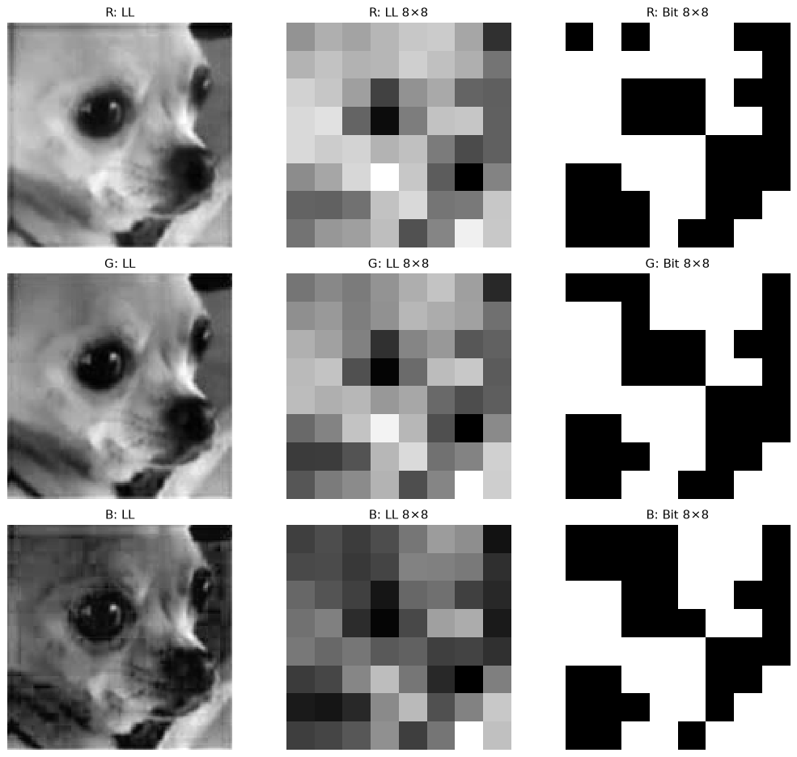

*Hình 3. LL, LL 8×8 và ma trận bit của từng kênh màu.*

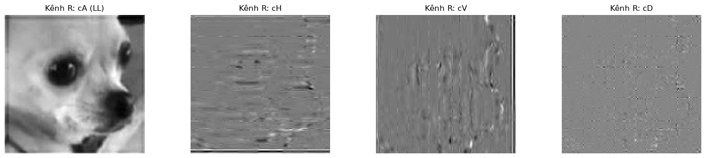

*Hình 4. LL và ba thành phần chi tiết trên kênh R; các panel dùng thang hiển thị riêng.*

Ảnh nguồn không được phân loại thành chó/bánh bởi ma trận bit. Bit chỉ ghi quan hệ hệ số với ngưỡng, không mang nhãn ngữ nghĩa. Phần chi tiết được hiển thị để hiểu DWT nhưng không đưa vào baseline LL.

### 4.2. YC2 — So sánh Hamming

Tạo 130 mã RGB 192 bit, tính khoảng cách cho 147 cặp trong CSV. Tổng Hamming bằng tổng số bit khác ở ba đoạn R/G/B. Heatmap dùng 26 ảnh gốc; số trục là thứ tự nguồn và có tên loại/file ở trục dọc. Các ô ngoài đường chéo bao gồm cả cặp không thuộc manifest đánh giá, vì heatmap nhằm quan sát tổng thể.

```python
labels = {
    split: np.array([int(p["label"]) for p in rows]) for split, rows in pairs.items()
}
distances = {
    split: np.array(
        [wh.hamming_distance(hashes[p["left_id"]], hashes[p["right_id"]]) for p in rows]
    )
    for split, rows in pairs.items()
}
for p in sample_pairs:
    distance = wh.hamming_distance(hashes[p["left_id"]], hashes[p["right_id"]])
    print(f"{p['left_id']} ↔ {p['right_id']}: nhãn={p['label']}, Hamming={distance}")
```

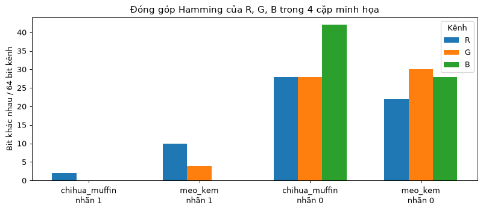

*Hình 5. Đóng góp Hamming của ba kênh ở bốn cặp minh họa.*

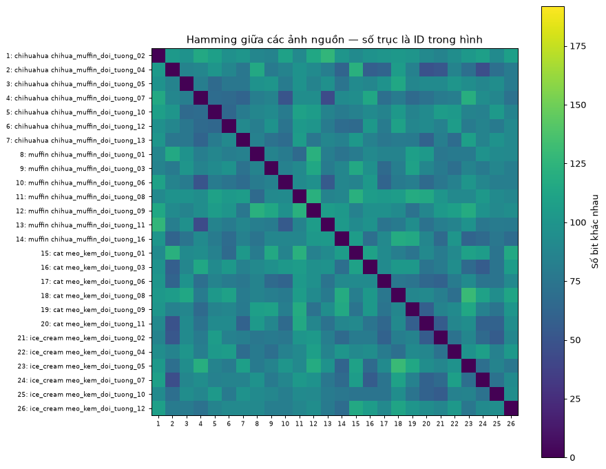

*Hình 6. Ma trận Hamming RGB giữa 26 ảnh nguồn.*

**calibration:**

- Cặp cùng nguồn: khoảng cách nhỏ nhất 0, lớn nhất 18 bit.
- Cặp khác loại: khoảng cách nhỏ nhất 50, lớn nhất 98 bit.

**evaluation:**

- Cặp cùng nguồn: khoảng cách nhỏ nhất 0, lớn nhất 20 bit.
- Cặp khác loại: khoảng cách nhỏ nhất 70, lớn nhất 126 bit.


Các cặp khác đối tượng có thể có khoảng cách gần nhau hơn dự kiến; ngưỡng RGB tách đúng calibration nhưng bỏ sót một cặp dương evaluation. Không suy ra thuật toán nhận biết loại chó/muffin hay mèo/kem.

### 4.3. YC3 — Khảo sát độ bền bổ sung

Dùng 12 ảnh calibration cho bốn biến thể dữ liệu và thêm crop giữa 80%, xoay 5°, lật ngang. Xoay giữ kích thước ảnh và dùng biên phản chiếu theo hàm biến đổi hiện có; crop lấy giữa rồi resize về kích thước cũ. Đây là khảo sát mô tả; các phép hình học không nằm trong cặp dương evaluation đã định nghĩa.

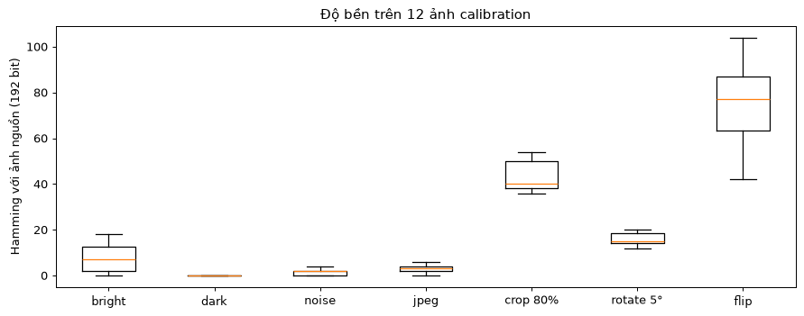

*Hình 7. Phân bố khoảng cách RGB với ảnh nguồn qua từng biến đổi trên calibration.*

- **bright:** median 7, min 0, max 18 bit.
- **dark:** median 0, min 0, max 0 bit.
- **noise:** median 2, min 0, max 4 bit.
- **jpeg:** median 3, min 0, max 6 bit.
- **crop 80%:** median 40, min 36, max 54 bit.
- **rotate 5°:** median 15, min 12, max 20 bit.
- **flip:** median 77, min 42, max 104 bit.

Tối ×0.7 cho mã không đổi trong mẫu này; nhiễu/JPEG chỉ đổi ít bit. Điều này phù hợp với việc LL giữ cấu trúc thô và dùng ngưỡng tương đối. Tăng sáng có thể clip vùng sáng, dẫn tới thay đổi mạnh hơn giảm sáng.

Crop và lật ngang thay bố cục, làm khoảng cách tăng. Với ngưỡng RGB 18 bit, crop tối thiểu 36 và flip tối thiểu 42 trong calibration sẽ bị xem là khác nguồn dù được tạo từ cùng ảnh. Đây là giới hạn quan trọng: kết quả evaluation không bao quát crop/lật hoặc góc chụp khác. Không đưa các biến đổi này vào test sau khi xem kết quả để rồi báo như đánh giá ban đầu.

### 4.4. YC4 — Chọn ngưỡng và đánh giá cuối

Chọn ngưỡng bằng Youden J = Recall + Specificity − 1 trên calibration. Xét các giá trị khoảng cách quan sát được và trường hợp dự đoán toàn âm; nếu nhiều ngưỡng cùng J thì lấy nhỏ nhất. Đây là tiêu chí lựa chọn bổ sung của project, không phải ngưỡng cố định trong slide.

```python
threshold = evaluation.select_threshold(labels["calibration"], distances["calibration"])
metrics = {
    split: evaluation.score_pairs(labels[split], distances[split], threshold)
    for split in pairs
}
print(f"Ngưỡng calibration: {threshold:g}/{len(demo_hash)} bit")
for split, values in metrics.items():
    print(
        split,
        {
            name: round(values[name], 3)
            for name in ("accuracy", "recall", "specificity", "auc")
        },
    )
```

Kết quả giữ nguyên ngưỡng calibration:

- **calibration:** τ=18; TP=48, TN=18, FP=0, FN=0; Accuracy=1.0000, Recall=1.0000, Specificity=1.0000; Precision=1.0000, F1=1.0000, AUC=1.0000.
- **evaluation:** τ=18; TP=55, TN=25, FP=0, FN=1; Accuracy=0.9877, Recall=0.9821, Specificity=1.0000; Precision=1.0000, F1=0.9910, AUC=1.0000.

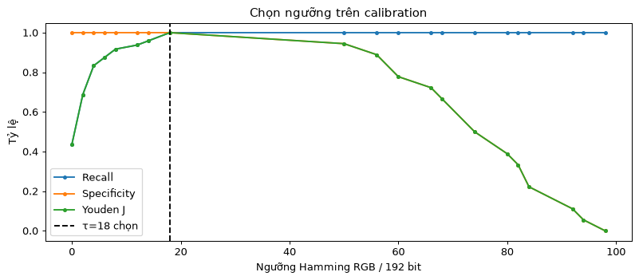

*Hình 8. Recall, Specificity và Youden J theo ngưỡng calibration; đường đứt là ngưỡng chọn.*

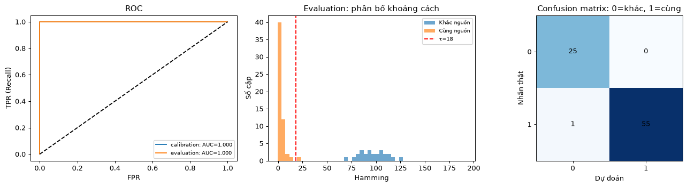

*Hình 9. ROC, phân bố khoảng cách evaluation và confusion matrix tại ngưỡng đã chọn.*

Phân tích riêng theo chủ đề trên evaluation với cùng ngưỡng:

- **chihua_muffin:** τ=18; TP=32, TN=16, FP=0, FN=0; Accuracy=1.0000, Recall=1.0000, Specificity=1.0000; Precision=1.0000, F1=1.0000, AUC=1.0000.
- **meo_kem:** τ=18; TP=23, TN=9, FP=0, FN=1; Accuracy=0.9697, Recall=0.9583, Specificity=1.0000; Precision=1.0000, F1=0.9787, AUC=1.0000.


Baseline RGB đạt đúng 80/81 cặp evaluation: 55 TP, 25 TN, 0 FP và 1 FN. Cặp bị bỏ sót là ảnh mèo/kem số 12 và bản tăng sáng của chính nó. R đổi 12 bit, G đổi 6 bit, B đổi 2 bit; tổng Hamming 20 > ngưỡng 18. ROC AUC vẫn 1.0 vì xếp hạng tổng thể tách hai lớp, nhưng ngưỡng đã chốt trên calibration không được chỉnh theo evaluation. Accuracy nếu luôn đoán lớp dương đã là 56/81 ≈ 69.1%, cho thấy cần đọc thêm Recall/Specificity.

Notebook hiển thị cặp evaluation dự đoán sai bằng ảnh RGB gốc. Không thay ngưỡng sau khi xem hình này.

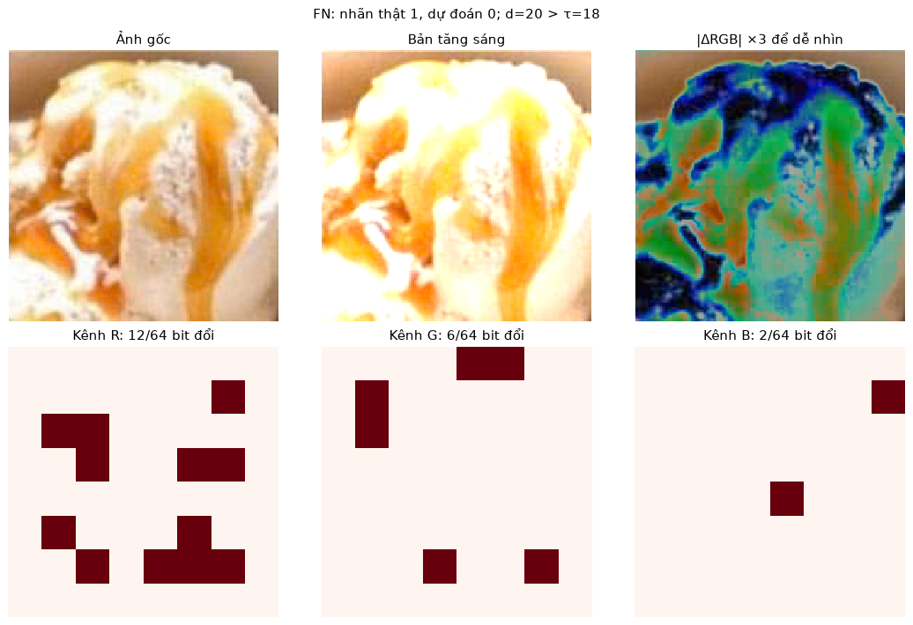

*Hình 10. Cặp cùng nguồn bị bỏ sót: ảnh gốc, bản tăng sáng, chênh lệch RGB được nhân 3 để dễ nhìn và vị trí bit khác nhau của R/G/B. Tổng Hamming 20 > ngưỡng 18.*

## 5. Hai bài nâng cao

### 5.1. Khảo sát phương pháp băm Wavelet

Giữ bốn cấu hình dễ đối chiếu: RGB LL–median với db4 level 1 (baseline), haar level 1, db4 level 2 và biến thể bước nhảy/modulo 2 dùng ảnh xám db4 level 3 theo ý tưởng slide 17. Mỗi cấu hình dùng cùng 130 ảnh, 66 cặp calibration và 81 cặp evaluation. Ngưỡng riêng chọn trên calibration; số liệu evaluation chỉ để đánh giá, không chọn lại baseline theo kết quả.

Độ dài khác nhau nên tất cả ngưỡng trong khảo sát này dùng Hamming chuẩn hóa. Một bit của mã ngắn và một bit của mã dài không có ý nghĩa tương đương để so trực tiếp số đếm thô. Chuẩn hóa làm cùng khoảng [0,1], nhưng vẫn cần dựa trên chỉ số phân loại vì hai biểu diễn mang lượng thông tin khác nhau.

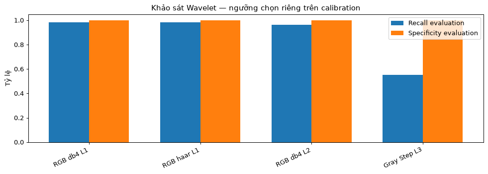

*Hình 11. Recall và Specificity evaluation của bốn cấu hình Wavelet.*

- **RGB db4 L1**: 192 bit; τ chuẩn hóa=0.093750; Accuracy=0.9877, Recall=0.9821, Specificity=1.0000, AUC=1.0000.
- **RGB haar L1**: 192 bit; τ chuẩn hóa=0.072917; Accuracy=0.9877, Recall=0.9821, Specificity=1.0000, AUC=1.0000.
- **RGB db4 L2**: 192 bit; τ chuẩn hóa=0.093750; Accuracy=0.9753, Recall=0.9643, Specificity=1.0000, AUC=1.0000.
- **Gray Step L3**: 71,542 bit; τ chuẩn hóa=0.294163; Accuracy=0.6914, Recall=0.5536, Specificity=1.0000, AUC=0.7157.

Baseline RGB có một FN ở ngưỡng chọn từ calibration. AUC vẫn bằng 1.0 vì thứ hạng có thể tách được hai lớp ở một ngưỡng khác, nhưng bài đánh giá phải giữ ngưỡng đã chọn từ calibration. Số liệu của bốn cấu hình không đủ để kết luận sóng mẹ nào tốt nhất nói chung.

Biến thể bước nhảy tạo mã 71.542 bit do ghép toàn bộ các hệ số với chế độ mở rộng biên, vượt xa 192 bit của baseline. Kết quả Recall khoảng 55.4% cho thấy nhiều bản chỉnh sửa cùng nguồn bị bỏ sót. Modulo 2 có thể đổi bit khi hệ số lượng tử hóa thay đổi chẵn/lẻ; độ dài lớn không bảo đảm biểu diễn tốt hơn.

Biến thể bước nhảy còn đổi hệ số dùng, thang cường độ, không gian màu và cách nhị phân hóa. Vì vậy không quy toàn bộ khác biệt của nó cho level hoặc loại wavelet.

### 5.2. Tìm kiếm ảnh dựa trên hash

Ứng dụng chạy trực tiếp trong notebook. Dùng một ảnh JPEG biến thể làm truy vấn, tính baseline hash và xếp hạng trong 14 ảnh gốc evaluation. Ảnh truy vấn không có mặt như một file giống hệt trong cơ sở dữ liệu; ảnh nguồn của nó có mặt để kiểm tra khả năng tìm lại nguồn.

Người dùng đổi biến `query_path` sang file riêng và chạy lại cell. Nếu chính file truy vấn nằm trong database, code loại file đó theo đường dẫn đã resolve. Không xây website vì đề không yêu cầu loại giao diện cụ thể.

```python
database = [s for s in sources if s["split"] == "evaluation"]
query_source = database[settings["retrieval_source_index"]]["source_id"]
query_id = f"{query_source}__{settings['retrieval_transform']}"
query_path = (
    root / metadata[query_id]["path"]
)  # đổi đường dẫn tại đây để thử ảnh của bạn
query_rgb, candidates, top_results = evaluation.retrieve_top_k(
    query_path, database, hashes, root, baseline, settings["top_k"]
)
visual.plot_retrieval(query_rgb, candidates, top_results, rgb_images, threshold)
```

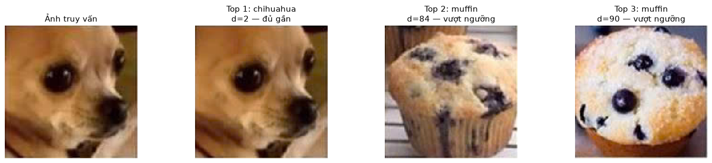

*Hình 12. Ảnh truy vấn và Top-3 kết quả hiển thị RGB, xếp theo Hamming của hash màu.*

Truy vấn hiện tại: `chihua_muffin_doi_tuong_02__jpeg`. Kết quả:

1. `chihua_muffin_doi_tuong_02`: Hamming **2**, cùng nguồn: **True**.
2. `chihua_muffin_doi_tuong_03`: Hamming **84**, cùng nguồn: **False**.
3. `chihua_muffin_doi_tuong_08`: Hamming **90**, cùng nguồn: **False**.


Top-1 tìm lại ảnh nguồn ở khoảng cách 2. Top-2/3 vẫn được hiển thị theo thứ hạng, nhưng vượt ngưỡng 18 nên không được kết luận đủ tương tự. Top-k là cách lấy các kết quả gần nhất ngay cả khi tất cả đều xa; việc chấp nhận cần xét ngưỡng riêng.

Đây là một ví dụ truy hồi, chưa phải phép đánh giá Recall@k trên nhiều truy vấn. Khi dùng ảnh ngoài bộ dữ liệu, phải kiểm tra kết quả theo thực tế; hash không tự biết nhãn đối tượng mới.

## 6. Thảo luận các câu hỏi mở rộng

Phần này mô tả hướng phát triển, chưa phải các tính năng hoặc kết quả đã được notebook kiểm chứng.

### 6.1. Cải thiện với ảnh xoay lớn

Biểu diễn LL theo lưới tọa độ thay đổi khi ảnh xoay, nhất là khi vị trí tương đối các vùng sáng tối đổi. Có thể chuẩn hóa hướng trước khi hash hoặc lưu nhiều hash cho các góc xoay. Cách nhiều hash làm tăng lưu trữ và số phép so sánh; đồng thời tăng cơ hội ảnh khác cũng có khoảng cách nhỏ, nên phải chọn lại tiêu chí đánh giá trên calibration phù hợp.

Định hướng bằng mô-men có thể không ổn định với nền phức tạp hoặc vật đối xứng. Log-polar hoặc biểu diễn khác là phương án nghiên cứu, không mặc định giải quyết được mọi biến đổi. Kết quả crop/flip hiện tại cho thấy cần thử riêng các biến đổi hình học trước khi mở rộng tuyên bố độ bền.

### 6.2. Tìm kiếm trên hàng triệu ảnh

Ví dụ hiện tại quét tuyến tính N mã và tính Hamming, chi phí khoảng O(NB). Với mã 192 bit đóng gói, XOR và popcount có thể giảm chi phí tính/lưu. Khi N lớn, có thể khảo sát BK-tree, multi-index hashing hoặc tìm kiếm gần đúng; hiệu quả phụ thuộc phân bố mã và bán kính tìm kiếm.

Không suy ra truy vấn toàn hệ thống là O(1) chỉ vì một thao tác tra bảng băm có chi phí trung bình hằng số. Vẫn có chi phí tạo ứng viên, duyệt kết quả và kiểm tra khoảng cách. Những cấu trúc này chưa được cài đặt hoặc benchmark trong bài.

### 6.3. Hash và vector đặc trưng học sâu

Hash của bài dùng cấu trúc thô của từng kênh màu, phù hợp thử tìm bản gần trùng với chi phí biểu diễn nhỏ. Đặc trưng học sâu có thể mang thông tin ngữ nghĩa tùy mô hình và cách huấn luyện. Không khẳng định mọi embedding hiểu ngữ nghĩa tốt hoặc bắt buộc chạy GPU; cần chọn theo bài toán, tài nguyên và dữ liệu.

Hai ảnh chó khác nhau có thể cùng ngữ nghĩa nhưng không cùng ảnh nguồn. Vì thế thay hash bằng embedding còn đòi hỏi xem lại tiêu chí tương tự và dữ liệu đánh giá. Có thể dùng hai giai đoạn: lọc ứng viên rồi so kỹ hơn, nhưng phải đo tỷ lệ bỏ sót ở bước đầu.

### 6.4. Wavelet Packet và DTCWT

DWT lấy mẫu có thể nhạy với dịch chuyển nhỏ. Wavelet Packet phân rã thêm các nhánh để khảo sát thông tin băng tần chi tiết hơn, nhưng tăng số lựa chọn đặc trưng; riêng việc thêm nhánh chưa đảm bảo bất biến dịch chuyển.

DTCWT là hướng nghiên cứu để có tính chọn hướng và độ ổn định dịch chuyển tốt hơn trong những điều kiện nhất định. Bài chưa sử dụng thư viện hoặc thí nghiệm cho WPT/DTCWT, vì vậy không đưa số liệu khẳng định chúng cải thiện trên 26 ảnh này. Nếu triển khai, cần so cùng split và quy tắc nhãn.

## 7. Kiểm tra quy trình và giới hạn

### 7.1. Audit

- **Kiến trúc:** dữ liệu và cặp do `src/data/lab04_pairs.py` chuẩn bị; hash ở `src/models/classical/wavelet_hash.py`; chọn ngưỡng/chấm cặp ở `src/pipelines/lab04_evaluation.py`; phần vẽ dài ở `src/pipelines/lab04_visuals.py` để notebook tập trung vào từng bước tính toán.
- **Đúng phạm vi:** đủ các bước cơ bản, hai bài nâng cao và khảo sát độ bền được ghi rõ là bổ sung. Không gán baseline RGB–LL–median–192 bit thành yêu cầu slide.
- **Quy chuẩn CV:** đường dẫn theo project root, không ghi đè ảnh nguồn; NumPy RGB `(H,W,3)`, hash `(192,)` uint8; seed nhiễu/split cố định. Các vòng lặp theo ảnh/cặp/thí nghiệm, không lặp từng pixel. Hàm có type hints và docstring. Bài CPU nên không có quy trình GPU/training.
- **Phạm vi code:** chỉ giữ các hàm phục vụ notebook hiện tại; đã bỏ pipeline mẫu cũ, bộ vẽ trùng và các thuật toán băm bổ sung chưa dùng. Các hướng mở rộng được thảo luận trong report không đồng nghĩa đã có triển khai.

### 7.2. Kiểm tra thực tế

- Notebook chạy toàn bộ từ kernel mới, không lỗi cell; đã xuất 12 hình từ output.
- Kiểm tra 130 mã có 192 bit nhị phân; code minh họa R|G|B khớp hàm baseline.
- Kiểm tra ma trận đôi một đối xứng và đường chéo bằng 0; nguồn calibration/evaluation không giao nhau; nhãn cặp đúng nguồn và cùng split.
- Test dữ liệu kiểm tra tái lập, nhãn, nguồn giữ nguyên; test baseline kiểm tra thứ tự R|G|B, dữ liệu float/uint8, shape không hợp lệ và ảnh hằng.
- Test chọn ngưỡng có trường hợp evaluation vẫn sai để bảo đảm không tự fit lại ngưỡng theo evaluation.
- Smoke và normal test, Ruff trên src/tests/notebook và Black trên src/tests được chạy sau khi dọn code. Các test riêng cho tính năng cũ đã bỏ được gỡ cùng tính năng; các kiểm tra hash, Hamming, dữ liệu, chọn ngưỡng và Top-k vẫn được giữ.

### 7.3. Giới hạn diễn giải

Tập nguồn chỉ có 26 ảnh đã chọn có chủ đích, hai chủ đề và một seed chia nhóm. Cặp dương là các biến đổi tổng hợp nhẹ, không có ảnh cùng vật ở góc chụp mới. Không có khoảng tin cậy hoặc đánh giá nhiều lần chia nhóm. Các kết quả hiện tại là minh họa học phần có kiểm tra thực thi, chưa phải benchmark đại diện cho tìm kiếm ảnh tự nhiên.

Nguồn/tác giả ảnh cần bổ sung nếu dùng để công bố rộng hơn. Hash không thay nhãn nguồn, không phân loại chó/bánh và không đưa ra kết luận bản quyền. Kết quả Hamming gần cần được người dùng xem lại theo mục tiêu thực tế.

## 8. Kết luận

Đã thực hiện luồng RGB → Wavelet từng kênh → lượng tử hóa → mã băm 192 bit → Hamming → đánh giá, với ngưỡng 18 bit chọn trên calibration. Baseline đúng 80/81 cặp evaluation, bỏ sót một bản tăng sáng và nhạy với crop/lật trong khảo sát bổ sung. Thử nhiều cấu hình cho thấy số bit lớn hơn không tự bảo đảm kết quả tốt hơn.

Tìm kiếm Top-3 đã tìm lại nguồn của một ảnh JPEG và hiển thị cả những ứng viên xa hơn. Hướng tiếp theo phù hợp là bổ sung ảnh cùng vật ở góc chụp mới, nhiều nguồn độc lập hơn và đánh giá nhiều truy vấn, giữ nguyên nguyên tắc chọn ngưỡng tách khỏi dữ liệu đánh giá.

## 9. Tài liệu đối chiếu

1. Slide Chapter 3 Part 1 trang 16–18 trong thư mục tài liệu học phần: yêu cầu, mô tả băm Wavelet và khung code.
2. [PyWavelets — 2D DWT](https://pywavelets.readthedocs.io/en/latest/ref/2d-dwt-and-idwt.html): cấu trúc hệ số, mức phân rã và chế độ biên.
3. [scikit-learn — roc_curve](https://scikit-learn.org/stable/modules/generated/sklearn.metrics.roc_curve.html): giao diện đánh giá ROC.
4. [Notebook hiện tại](../../../notebooks/labs/lab_04.ipynb), [cấu hình hash](../../../configs/experiment/lab04_wavelet.yaml), [cấu hình dữ liệu](../../../configs/dataset/lab04_pairs.yaml): nguồn tái lập thí nghiệm.
