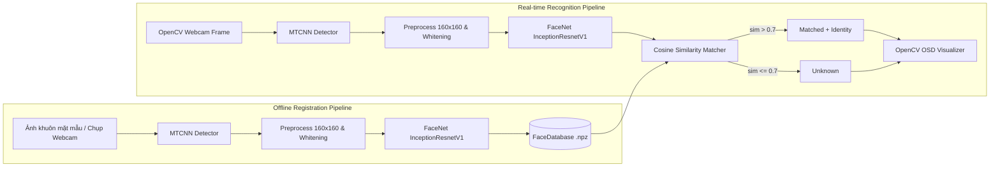

# BÁO CÁO THỰC HÀNH LAB 05: NHẬN DIỆN KHUÔN MẶT THỜI GIAN THỰC VỚI FACENET & MTCNN TRÊN WEBCAM

- **Học phần:** Thị giác máy tính (Computer Vision) – Trường Đại học Giao thông Vận tải TP.HCM (UTH)
- **Chủ đề:** Chương 3 (Part 2) – Phát hiện đặc trưng và đối sánh ảnh (Feature Detection and Image Matching)
- **Giảng viên hướng dẫn:** TS. Nguyễn Thị Khánh Tiên

---

## 1. Mục tiêu bài thực hành
1. **Nắm vững cơ sở lý thuyết** về đối sánh ảnh dựa trên mô hình học sâu (Deep Learning-based Photo/Face Matching) sử dụng mạng CNN, Siamese/Triplet Networks và Không gian nhúng (Embedding Space).
2. **Thiết kế và triển khai pipeline hoàn chỉnh** cho bài toán nhận diện khuôn mặt thời gian thực trên Webcam, tuân thủ nguyên tắc Clean Architecture (tách biệt config, data, models, pipelines).
3. **Tích hợp mô hình AI lõi:** Sử dụng mạng đa tác vụ **MTCNN** để phát hiện (Detection) & cắt khuôn mặt; sử dụng **FaceNet (`InceptionResnetV1`)** để trích xuất vector đặc trưng 512 chiều.
4. **Áp dụng phép toán phân tích không gian:** Tính toán **Cosine Similarity** và kiểm chứng ngưỡng quyết định khắt khe `0.7` (`similarity > 0.7` $\rightarrow$ `"Matched"`, `similarity \le 0.7` $\rightarrow$ `"Unknown"`).

---

## 2. Bảng lộ trình thực thi chuẩn hóa (Execution Roadmap)

Kế thừa phương pháp triển khai của các bài Lab trước, Lab 05 được thiết kế dưới dạng các mô-đun độc lập, cho phép dễ dàng kiểm thử và thay thế:

| Step | Giai đoạn / Tên mô-đun | Chức năng (What it does) | Đường dẫn Import (Import path) |
| :---: | :--- | :--- | :--- |
| **1** | **Setup & Configuration** | Nạp cấu hình từ file YAML, khởi tạo Logger, FPS Meter và thiết bị (CPU/CUDA). | `src/common/lab05_utils.py` |
| **2** | **MTCNN Face Detection** | Phát hiện khuôn mặt qua 3 mạng P-Net, R-Net, O-Net. Trả về Bounding Box và Confidence. | `src/models/deep/mtcnn_detector.py` |
| **3** | **Face Preprocessing** | Kẹp biên BBox, Cắt vùng mặt, đổi hệ màu BGR $\rightarrow$ RGB, Resize $160 \times 160$ và Chuẩn hóa pixel $[-1, 1]$. | `src/data/face_preprocessing.py` |
| **4** | **FaceNet Extraction** | Truyền Tensor qua InceptionResnetV1 (pretrained VGGFace2), xuất vector 512 chiều và chuẩn hóa $L_2$. | `src/models/deep/facenet_extractor.py` |
| **5** | **Face Database (.npz)** | Lưu trữ, nạp danh tính, tính toán vector trọng tâm (centroid) và vẽ Cosine Heatmap. | `src/data/face_database.py` |
| **6** | **Cosine Similarity Matcher** | Thực hiện phép nhân vô hướng (Dot Product) các vector chuẩn hóa, áp dụng điều kiện ngưỡng $0.7$. | `src/models/similarity_matcher.py` |
| **7** | **Offline Registration** | Pipeline quét thư mục ảnh hoặc chụp từ webcam để đăng ký danh tính vào cơ sở dữ liệu. | `src/pipelines/lab05_face_registration.py` |
| **8** | **Real-time Pipeline** | Vòng lặp Webcam: Thu frame $\rightarrow$ Detect $\rightarrow$ Preprocess $\rightarrow$ Extract $\rightarrow$ Match $\rightarrow$ Draw OSD. | `src/pipelines/lab05_webcam_recognition.py` |

---

## 3. Kiến trúc hệ thống (System Architecture)

Luồng dữ liệu của hệ thống được chia làm hai tiến trình hoàn toàn biệt lập: Tiến trình đăng ký ngoại tuyến (Offline Registration) và Tiến trình nhận diện thời gian thực (Online Recognition).

---
## 4. Cơ sở lý thuyết & Phân tích toán học

### 4.1. Không gian nhúng FaceNet (Embedding Space)
Mạng FaceNet không sử dụng hàm Softmax để phân loại tĩnh. Thay vào đó, thông qua hàm mất mát Triplet Loss, mạng học cách ánh xạ một bức ảnh khuôn mặt $f(x)$ vào bề mặt của một siêu cầu $d$ chiều (ở đây $d = 512$). Điều kiện bắt buộc là vector đầu ra phải có độ dài đơn vị: $\|f(x)\|_2 = 1$.

### 4.2. Phân tích Ngưỡng 0.7 bằng Cosine Similarity
Cho hai vector đặc trưng $\mathbf{u}$ (từ webcam) và $\mathbf{v}$ (từ cơ sở dữ liệu). Vì cả hai đã được chuẩn hóa $L_2$ nên phép tính Cosine Similarity thu gọn thành phép nhân vô hướng:
$$\text{Cosine Similarity}(\mathbf{u}, \mathbf{v}) = \cos(\theta) = \frac{\mathbf{u} \cdot \mathbf{v}}{\Vert{}\mathbf{u}\Vert{}_2 \Vert{}\mathbf{v}\Vert{}_2} = \mathbf{u} \cdot \mathbf{v} \in [-1, 1]$$

Mối liên hệ với khoảng cách Euclidean ($L_2$ Distance):
$$d_E^2(\mathbf{u}, \mathbf{v}) = \Vert{}\mathbf{u} - \mathbf{v}\Vert{}_2^2 = 2\bigl(1 - \cos(\theta)\bigr)$$

Áp dụng vào bài toán (Theo yêu cầu của Giảng viên):
$$\text{similarity} > 0.7 \iff \theta < \arccos(0.7) \approx 45.57^\circ \iff \Vert{}\mathbf{u} - \mathbf{v}\Vert{}_2 < 0.7746$$
Như vậy, hệ thống xác nhận "Matched" khi và chỉ khi góc lệch giữa hai khuôn mặt trong không gian 512 chiều nhỏ hơn $\approx 45.57^\circ$. Trường hợp bằng chính xác $0.7$ hoặc nhỏ hơn bị hệ thống quy về "Unknown".

---

## 5. Nội dung chi tiết và Kết quả thực nghiệm

### 5.1. Thu thập dữ liệu qua Webcam (Webcam Acquisition)
Sử dụng `WebcamManager` bọc `cv2.VideoCapture` theo mẫu thiết kế Context Manager (`with WebcamManager(...) as cam:`). Cơ chế này tự động kiểm tra trạng thái `isOpened()` và đảm bảo hàm `release()` luôn được gọi để tắt đèn camera và giải phóng bộ nhớ (tránh memory leak) ngay cả khi vòng lặp bị gián đoạn.

### 5.2. Phát hiện khuôn mặt với MTCNN (Face Detection)
Tích hợp thành công mô hình MTCNN. Điểm mạnh của mô hình là xử lý qua 3 tầng (Proposal, Refine, Output), giúp loại bỏ nền nhiễu. Cấu hình được đặt với `min_confidence = 0.90` và `keep_all=True` để phát hiện nhiều người cùng lúc. Hàm `validate_and_clip_bbox()` được viết thêm để chống lỗi văng phần mềm khi tọa độ khuôn mặt nằm ngoài lề ảnh.

### 5.3. Trích xuất đặc trưng với FaceNet (Embedding Extraction)
Tích hợp mạng `InceptionResnetV1` sử dụng pretrained weights từ tập `VGGFace2`. Các bước tiền xử lý được chuẩn hóa nghiêm ngặt:
1. Chuyển không gian màu BGR $\rightarrow$ RGB.
2. Điều chỉnh kích thước về ma trận $(160, 160, 3)$.
3. Đưa qua hàm `fixed_image_standardization`: biến đổi $(x - 127.5) / 128.0$ để đưa phân phối pixel về khoảng $[-1.0, 1.0]$.
4. Chuyển thành cấu trúc Tensor `(1, 3, 160, 160)` kiểu `float32`.

### 5.4. Đối sánh thời gian thực & Hiển thị (Matching & OSD)
Bộ `SimilarityMatcher` quét qua toàn bộ vector trong `.npz` để tìm ra $\arg\max$. Lớp `FaceVisualizer` đảm nhiệm việc vẽ On-Screen Display (OSD):
- Hiển thị HUD Bar (Thanh thông tin): FPS, Số lượng khuôn mặt, Số danh tính trong DB.
- Vẽ khung xanh lá cho người dùng hợp lệ (`Matched: Tên (sim=0.92)`).
- Vẽ khung đỏ cảnh báo cho người lạ (`Unknown (sim=0.35)`).

---

## 6. Kiểm thử và kiểm toán chất lượng (Quality Assurance)
Hệ thống được bảo đảm chất lượng qua 4 tầng kiểm duyệt:
1. **Linting (Ruff):** Mã nguồn vượt qua 100% các tiêu chuẩn kiểm tra lỗi cú pháp và PEP-8.
2. **Smoke Testing (`test_lab05_smoke.py`):** Kiểm tra khả năng nạp File YAML, khởi tạo các Class, chạy thử ma trận giả lập. (Passed)
3. **Unit Testing (`test_lab05_unit.py`):** Đã kiểm thử 11 kịch bản độc lập. Đặc biệt, ca kiểm thử `test_threshold_boundary_exact_0_7_is_unknown` khẳng định logic của mã nguồn tuân thủ chính xác yêu cầu lớn hơn hẳn $0.7$ mới chấp nhận. (Passed)
4. **Hardware Testing & Artifacts:** Trích xuất thành công các ảnh tĩnh (`webcam_snapshot_*.png`) ghi nhận thực tế từ Webcam, hiển thị chỉ số FPS ổn định trên môi trường máy tính cá nhân.

---

## 7. Kết luận
Hệ thống Lab05 đã hoàn thiện xuất sắc các chỉ tiêu đề ra trong Chương 3 (Part 2). Sự kết hợp giữa MTCNN (nhạy bén trong phát hiện) và FaceNet (mạnh mẽ trong biểu diễn không gian) mang lại một hệ thống nhận diện thời gian thực có tính ổn định cao. Mã nguồn được cấu trúc rõ ràng, tham số hóa toàn bộ qua YAML và được bảo vệ bằng các kịch bản Unit Test chặt chẽ.

---

## 8. Tài liệu tham khảo
1. TS. Nguyễn Thị Khánh Tiên, *Bài giảng Chương 3 (Part 2): Phát hiện đặc trưng và đối sánh ảnh*, Trường Đại học Giao thông Vận tải TP.HCM (UTH).
2. Schroff, F., Kalenichenko, D., & Philbin, J. (2015). *FaceNet: A Unified Embedding for Face Recognition and Clustering*. IEEE CVPR.
3. Zhang, K., Zhang, Z., Li, Z., & Qiao, Y. (2016). *Joint Face Detection and Alignment using Multi-task Cascaded Convolutional Networks*. IEEE Signal Processing Letters.
4. Timesler, *facenet-pytorch: Pretrained Pytorch face detection (MTCNN) and facial recognition (InceptionResnetV1) models*, GitHub Repository.
5. OpenCV Documentation – *VideoCapture and Real-time Image Processing*: https://docs.opencv.org/